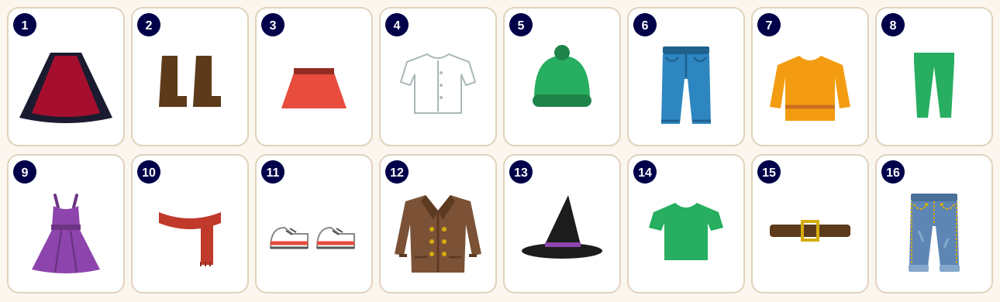
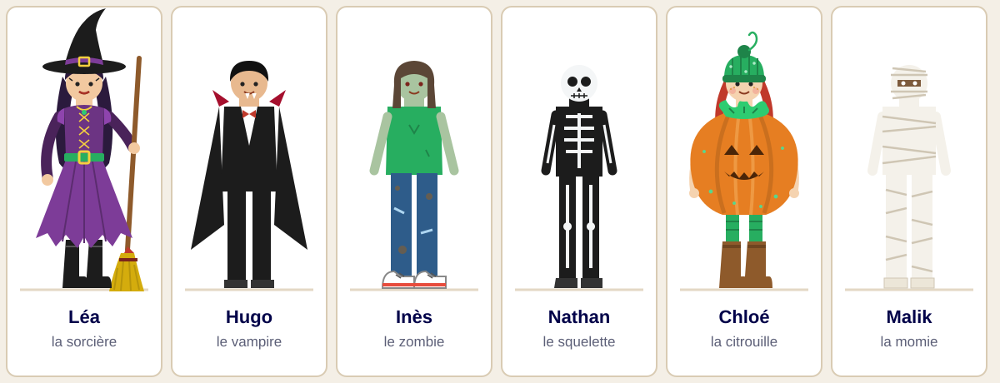
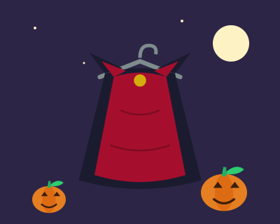
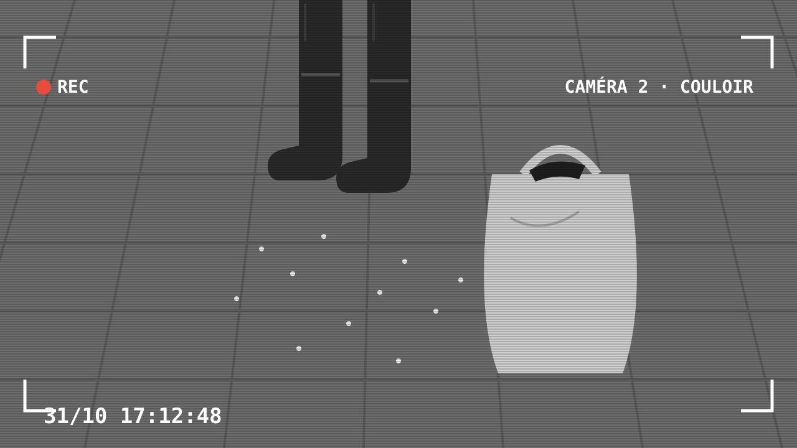
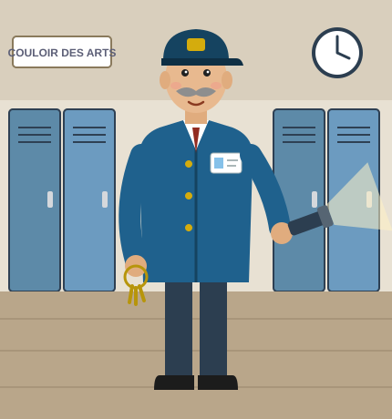
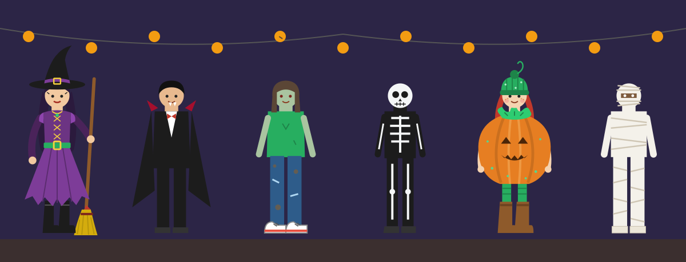

## La salle des costumes {.titre-blanc background-image="img/salle_costumes.svg" background-size="contain" background-position="bottom" background-color="#3a2f55"}

::: {.absolute bottom=10 left=10 width=640 style="background: rgba(255,255,255,.62); color: #1c1c2e; border-radius: 14px; padding: 0.35em 0.8em; font-size: 0.6em; text-align: center;"}
Vendredi 31 octobre, 17 h 30. Le club théâtre prépare le **bal d'Halloween**.\
Mais le cintre est **vide** : la **cape de Dracula** a disparu ! Six élèves sont suspects. **Trouve le coupable !**
:::

## Les vêtements {.smaller}

{height="300" fig-align="center"}

**Relie** le mot et le numéro.

::: {style="font-size: 0.95em; line-height: 1.8; text-align: center;"}
des baskets · un bonnet · des bottes · une cape · une ceinture · un chapeau · une chemise · des collants\
une écharpe · un jean · une jupe · un manteau · un pantalon · un pull · une robe · un t-shirt
:::

## Grammaire : l'accord des couleurs {.smaller}

:::: {.columns}
::: {.column width="56%"}
**Écris** la couleur à la bonne forme.

1. une robe (violet) → une robe ________
2. des collants (vert) → des collants ________
3. une chemise (blanc) → une chemise ________
4. des bottes (marron) → des bottes ________
5. une cape (noir) et (rouge) → une cape ________ et ________
6. des robes (orange) → des robes ________
7. un bonnet (vert) → un bonnet ________
:::
::: {.column width="44%"}
::: {.callout-tip}
## Rappel

La couleur s'accorde avec le nom.

| | |
|---|---|
| féminin | **+ e** : vert → vert**e** |
| pluriel | **+ s** : vert → vert**s** |
| féminin pluriel | **+ es** : vert → vert**es** |

Attention :

- rouge, jaune, rose : déjà un **e** au masculin
- blanc → blan**che** · violet → violet**te**
- **marron** et **orange** ne changent pas : *des bottes marron*
:::
:::
::::

## Les suspects

{fig-align="center"}

## Qui porte quoi ? {.smaller}

:::: {.columns}
::: {.column width="60%"}
**Lis** la phrase. **Regarde** les suspects. **Écris** le prénom.

1. Elle porte une robe longue violette et un chapeau noir. → ________
2. Il porte un costume noir élégant et une chemise blanche. → ________
3. Elle porte un t-shirt vert et un jean sale. → ________
4. Il porte une combinaison noire moulante. → ________
5. Elle porte une robe orange, des collants verts et un bonnet vert. → ________
6. Il porte un pantalon blanc et des bandes blanches. → ________
:::
::: {.column width="40%"}

:::
::::

## Conjugaison : le verbe porter {.smaller}

:::: {.columns}
::: {.column width="56%"}
**Complète** avec le verbe *porter* au présent.

1. Léa ________ une robe violette.
2. Nous ________ des costumes d'Halloween.
3. Tu ________ un bonnet ?
4. Hugo et Nathan ________ du noir.
5. Vous ________ des bottes.
6. Je ________ un pull chaud.
:::
::: {.column width="44%"}
::: {.callout-tip}
## Rappel

**porter** (comme les verbes en -er)

| | |
|---|---|
| je port**e** | nous port**ons** |
| tu port**es** | vous port**ez** |
| il, elle port**e** | ils, elles port**ent** |

*Elle **porte** une robe.*\
*Ils **portent** des bottes.*
:::
:::
::::

## Positif, négatif ou neutre ? {.smaller}

:::: {.columns}
::: {.column width="50%"}
**Classe** les adjectifs dans le tableau.

::: {style="font-size: 0.95em; line-height: 1.7;"}
élégant · démodé · coloré · hideux · chic · vieux · somptueux · laid · vintage · sale · confortable · moche · blanc · long · court · traditionnel · nouveau · moulant
:::
:::
::: {.column width="50%"}
```{=html}
<div style="display:grid; grid-template-columns:repeat(3,1fr); gap:10px;">
  <div style="border:3px solid #27ae60; border-radius:12px; min-height:280px; padding:6px 10px; background:#eef8f1; font-weight:700;">🙂 Positif</div>
  <div style="border:3px solid #f60303; border-radius:12px; min-height:280px; padding:6px 10px; background:#fdecec; font-weight:700;">🙁 Négatif</div>
  <div style="border:3px solid #9aa0b8; border-radius:12px; min-height:280px; padding:6px 10px; background:#f2f3f7; font-weight:700;">😐 Neutre</div>
</div>
```
:::
::::

**Donne ton avis** sur un costume : *Je trouve le costume de Hugo **élégant**.* · *Le costume d'Inès est **sale**.*

## Grammaire : la place de l'adjectif {.smaller}

:::: {.columns}
::: {.column width="56%"}
**Écris** l'adjectif à la bonne place.

1. un costume (beau) → ________________
2. une cape (noire) → ________________
3. un chapeau (petit) → ________________
4. une robe (élégante) → ________________
5. un pull (joli) → ________________
6. des bottes (vieilles) → ________________
7. un bonnet (vert) → ________________
:::
::: {.column width="44%"}
::: {.callout-tip}
## Rappel

En général, l'adjectif est **après** le nom :

*une cape **noire**, une robe **élégante***

Quelques adjectifs courts sont **avant** le nom :

**beau, joli, petit, grand, vieux, nouveau, bon, mauvais**

*un **beau** costume, un **petit** chapeau*

Devant *des* + adjectif, on écrit souvent **de** :\
*de vieilles bottes*
:::
:::
::::

## La fiche d'enquête

::: {style="font-size: 0.8em;"}
Recopie la fiche. À chaque indice, **barre** les suspects.

| Suspect | Indice 1 | Indice 2 | Indice 3 | Barré ? |
|---|---|---|---|---|
| Léa | | | | |
| Hugo | | | | |
| Inès | | | | |
| Nathan | | | | |
| Chloé | | | | |
| Malik | | | | |
:::

## Indice 1 : le journal du collège {.smaller}

::: {.indice style="font-family: Georgia, serif;"}
**LE PETIT JOURNAL DU COLLÈGE**

**VOL AU CLUB THÉÂTRE !**

Vendredi 31 octobre, la célèbre cape de Dracula a disparu de la salle des costumes. Cette cape est très vieille : elle a 50 ans ! Elle est longue, noire et rouge, en velours. C'est un costume vintage et somptueux.

La cape a disparu entre 17 heures et 17 h 30. À ce moment-là, Hugo, Nathan et Malik répétaient une danse au gymnase avec le professeur de sport.

Par terre, dans la salle des costumes, il y avait des **paillettes vertes**…

Le bal d'Halloween commence à 19 heures. Qui a pris la cape ?
:::

## Indice 1 : questions {.smaller}

:::: {.columns}
::: {.column width="62%"}
1. Qu'est-ce qui a disparu ? Où ? Quand ?
2. **Souligne** dans le texte les adjectifs pour décrire la cape.
3. Ces adjectifs sont positifs, négatifs ou neutres ?
4. Où étaient Hugo, Nathan et Malik ?
5. Qu'est-ce qu'il y avait par terre ?
6. Qui porte du **vert** ? Regarde les suspects.

**Barre** trois suspects sur ta fiche.
:::
::: {.column width="38%"}

:::
::::

## Indice 2 : la caméra du couloir {.titre-blanc background-image="img/camera.svg" background-size="contain" background-color="#3d3d3d"}

## Indice 2 : questions {.smaller}

:::: {.columns}
::: {.column width="55%"}
**Observe** l'image de la caméra.

1. Quelle heure est-il sur l'image ?
2. Qu'est-ce qu'on voit ? Coche.\
   ☐ des baskets ☐ des bottes ☐ un chapeau\
   ☐ un grand sac ☐ une cape ☐ des paillettes
3. L'image est en noir et blanc. Est-ce qu'on voit les couleurs ?
4. Qui porte des **bottes** ? Qui porte des **baskets** ?

**Barre** un suspect.
:::
::: {.column width="45%"}

:::
::::

## Indice 3 : le témoin {.smaller}

:::: {.columns}
::: {.column width="38%"}
{height="460"}
:::
::: {.column width="62%"}
**Écoute** le témoignage de Monsieur Gaspard, le gardien.

**Coche** ce que tu entends.

| | | |
|---|---|---|
| ☐ un chapeau | ☐ un bonnet | ☐ vert |
| ☐ violet | ☐ une robe longue | ☐ une robe courte |
| ☐ large | ☐ moulant | ☐ des collants |
| ☐ un jean | ☐ des bottes marron | ☐ des baskets |

**Qui est le coupable ?** C'est ____________ !
:::
::::

## Conjugaison : l'imparfait {.smaller}

:::: {.columns}
::: {.column width="56%"}
Le gardien raconte : *« Elle **portait** un grand sac. Sa robe **était** orange. »*

**Complète** avec le verbe à l'imparfait.

1. Le gardien (nettoyer) ________ le couloir.
2. Chloé (porter) ________ un grand sac.
3. Sa robe (être) ________ orange.
4. Nous (avoir) ________ peur.
5. Tu (porter) ________ un bonnet.
6. Les garçons (danser) ________ au gymnase.
:::
::: {.column width="44%"}
::: {.callout-tip}
## Rappel

L'imparfait sert à **décrire** dans le passé.

Radical de *nous* au présent + terminaison :\
*nous **port**ons → je **port**ais*

| | |
|---|---|
| je **-ais** | nous **-ions** |
| tu **-ais** | vous **-iez** |
| il, elle **-ait** | ils, elles **-aient** |

Attention : **être** → j'**ét**ais
:::
:::
::::

## Les aveux de Chloé {.titre-blanc background-image="img/aveux.svg" background-size="contain" background-position="bottom" background-color="#2c2546"}

::: {style="background: rgba(255,255,255,.62); color: #1c1c2e; border-radius: 14px; padding: 0.5em 0.9em; width: 50%; font-size: 0.7em; margin-top: 0.4em;"}
« Oui, c'est moi… Lundi, des élèves ont regardé mon costume de citrouille. Ils ont dit : *Il est moche ! Il est démodé !* J'étais très triste.

La cape de Dracula est élégante et somptueuse. Je voulais être belle pour le bal. Je voulais rendre la cape après la fête.

Pardon ! »
:::

::: {style="background: rgba(255,255,255,.62); color: #1c1c2e; border-radius: 14px; padding: 0.4em 0.9em; width: 50%; font-size: 0.7em; margin-top: 0.5em;"}
**À toi !** Dis un compliment sur le costume de Chloé.\
*Ton costume est… Je trouve ta robe…*
:::

## Écriture : mon costume pour le bal {.smaller}

:::: {.columns}
::: {.column width="58%"}
Tu vas au bal d'Halloween du collège. **Décris** ton costume en 5 ou 6 phrases.

::: {style="background:#f7f3ea; padding: 0.5em 0.9em; font-family: Georgia, serif; line-height: 1.7;"}
Pour le bal, je suis déguisé(e) en ____________ .\
Je porte ____________ et ____________ .\
Mon costume est ____________ et ____________ .\
J'aime mon costume parce qu'il est ____________ .\
Je trouve le costume de ____________ ____________ .
:::
:::
::: {.column width="42%"}
::: {.indice}
**La boîte à mots**

**Vêtements** : une robe, une cape, un chapeau, un bonnet, des bottes, des collants, un pull…

**Couleurs** : noir, blanc, rouge, violet, vert, orange…

**Adjectifs** : élégant, chic, coloré, somptueux, vintage, confortable, long, court, large…
:::
:::
::::

# Affaire résolue !

{fig-align="center"}

La cape de Dracula est retrouvée. Bon bal d'Halloween !
