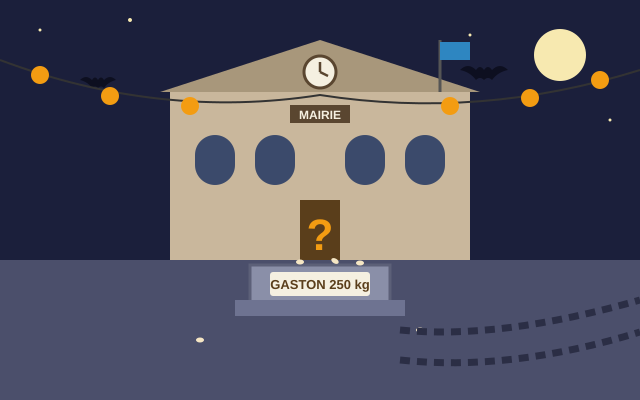
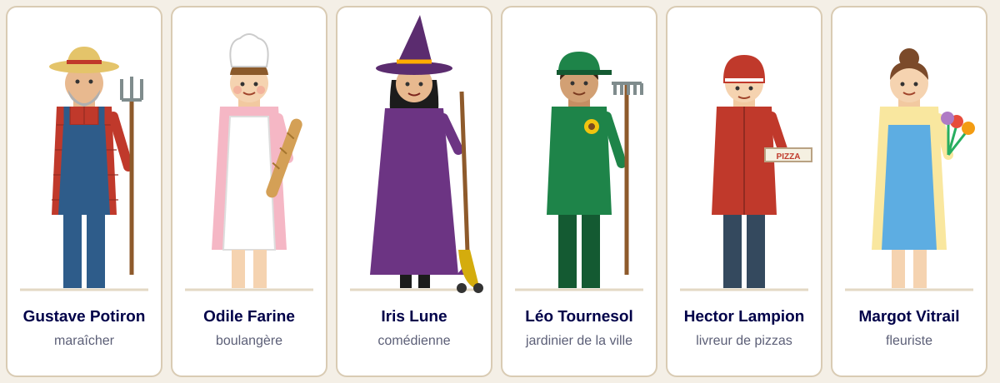
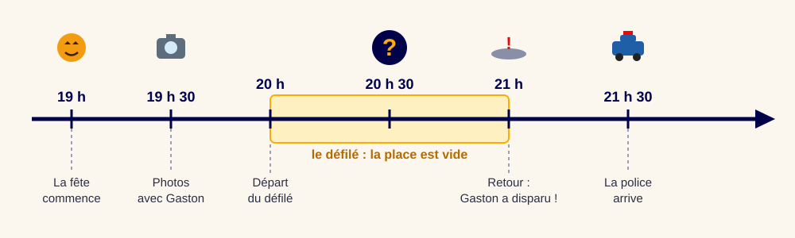
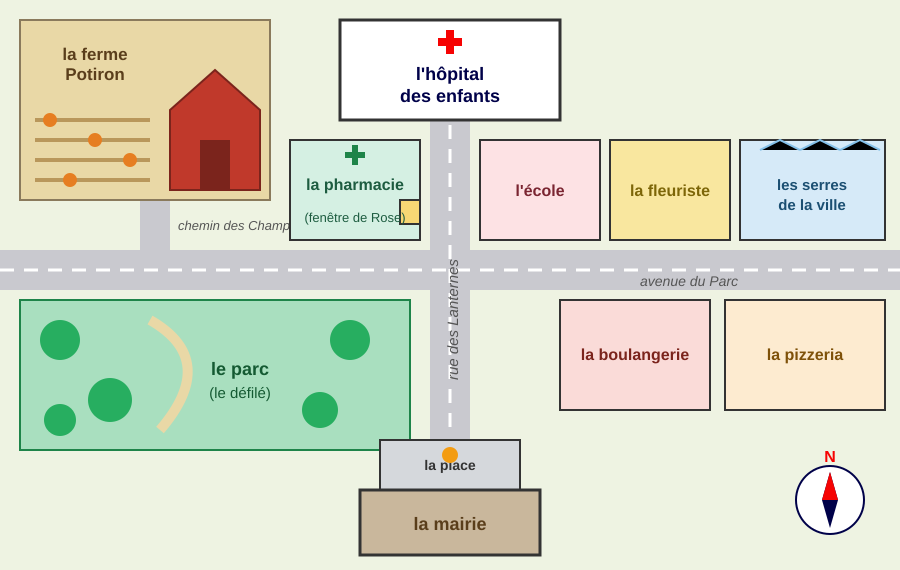
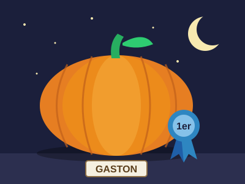
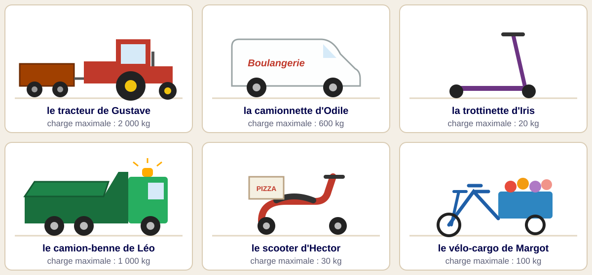
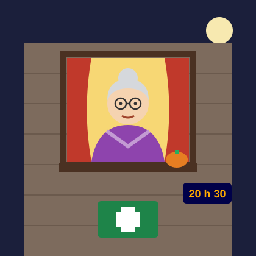
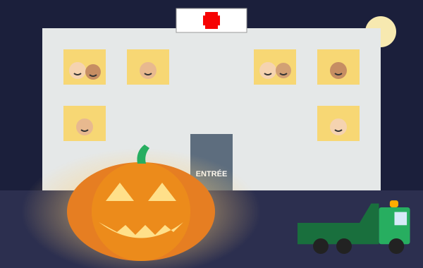

## L'affaire

:::: {.columns}
::: {.column width="55%"}
::: {style="font-size: 0.68em;"}
Brumeville, le soir du 31 octobre. Toute la ville fête Halloween ! Les rues sont décorées de lanternes, de toiles d'araignée et de chauves-souris en papier.

Sur la place de la Mairie, il y a **Gaston**, la citrouille géante qui a gagné le premier prix du concours. Elle pèse **250 kilos** ! Tout le monde vient la prendre en photo.

À 20 heures, les habitants partent au parc pour le grand défilé déguisé. La place est vide.

À 21 heures, quand Madame la Maire revient sur la place… **Gaston a disparu !** Il ne reste que son socle, quelques graines… et des traces de pneus.

**Six personnes sont suspectes. À toi de trouver le coupable !**
:::
:::
::: {.column width="45%"}

:::
::::

## Les suspects

Décris chaque suspect : son métier, ses vêtements, ce qu'il ou elle tient.

## La frise de la soirée {.smaller}

{fig-align="center"}

1. À quelle heure la fête commence-t-elle ?
2. Combien de temps dure le défilé ?
3. Entre quelle heure et quelle heure Gaston a-t-il disparu ?
4. Que se passe-t-il à 21 h 30 ?

## Le plan de Brumeville {.smaller}

:::: {.columns}
::: {.column width="62%"}

:::
::: {.column width="38%"}
Observe le plan et la rose des vents.

1. Quel bâtiment se trouve **au bout** de la rue des Lanternes, au nord ?
2. Qu'y a-t-il **en face de** la pharmacie, de l'autre côté de la rue ?
3. Le parc est-il à l'est ou à l'ouest de la rue des Lanternes ?
4. Où habite Gustave ? Où travaille Léo ?
:::
::::

## La fiche d'enquête

::: {style="font-size: 0.75em;"}
Recopie la fiche. Complète-la pendant l'enquête.

| Suspect | Un alibi ? | Son véhicule peut porter Gaston ? | Couleur du véhicule | Barré ? |
|---|---|---|---|---|
| Gustave Potiron | | | | |
| Odile Farine | | | | |
| Iris Lune | | | | |
| Léo Tournesol | | | | |
| Hector Lampion | | | | |
| Margot Vitrail | | | | |
:::

## Indice 1 : le journal {.smaller}

::: {.indice style="font-family: Georgia, serif;"}
**LA GAZETTE DE BRUMEVILLE, édition spéciale**

**OÙ EST PASSÉ GASTON ?**

Hier soir, Gaston, la citrouille géante de Brumeville, a disparu de la place de la Mairie pendant le défilé d'Halloween.

Gaston pesait 250 kilos. « Il est impossible de le porter à la main, même à dix personnes ! explique le policier Martin. Le voleur a forcément utilisé un véhicule. » D'ailleurs, des traces de pneus partent du socle de la citrouille.

Pendant tout le défilé, la boulangère Odile Farine était au parc. Elle distribuait des parts de tarte à la citrouille aux enfants, devant plus de cent personnes. Quant à Iris Lune, elle jouait la sorcière en tête du défilé, sur sa trottinette décorée en balai. Tout le monde l'a vue !

La police cherche maintenant des témoins. Si vous avez vu quelque chose, appelez la mairie !
:::

## Indice 1 : questions

:::: {.columns}
::: {.column width="65%"}
1. Qu'est-ce qui a disparu ? Où ? Quand ?
2. Pourquoi le voleur a-t-il **forcément** utilisé un véhicule ?
3. Qu'a-t-on trouvé près du socle ?
4. Où était Odile pendant le défilé ? Qui peut le confirmer ?
5. Que faisait Iris Lune ?

Barre deux suspects sur ta fiche.
:::
::: {.column width="35%"}

:::
::::

## Grammaire : a / à, est / et {.smaller}

:::: {.columns}
::: {.column width="58%"}
Complète avec **a** ou **à**, **est** ou **et**.

1. Le policier ___ trouvé des traces ___ côté du socle.
2. Odile ___ distribué des tartes ___ la citrouille.
3. La place ___ vide ___ silencieuse.
4. Gaston ___ une citrouille énorme ___ très lourde.
5. Le défilé ___ parti ___ 20 heures.
6. Madame la Maire ___ inquiète ___ elle ___ appelé la police.
:::
::: {.column width="42%"}
::: {.callout-tip}
## Rappel de cours

**a** = verbe *avoir* : on peut le remplacer par **avait**.\
*Il **a** (avait) trouvé des traces.*

**à** = petit mot invariable : on ne peut pas dire *avait*.\
*Il part **à** 20 heures.*

**est** = verbe *être* : on peut le remplacer par **était**.\
*La place **est** (était) vide.*

**et** = mot de liaison : on peut le remplacer par **et puis**.\
*vide **et** (et puis) silencieuse*
:::
:::
::::

## Indice 2 : les véhicules

{height="560" fig-align="center"}

## Indice 2 : questions

:::: {.columns}
::: {.column width="60%"}
Gaston pèse **250 kg**.

1. Range les véhicules du plus faible au plus fort, selon leur charge maximale.
2. Quels véhicules peuvent transporter Gaston ? Lesquels ne le peuvent pas ?
3. Le vélo-cargo de Margot peut porter 100 kg. Combien de kilos manque-t-il pour porter Gaston ?

Barre les suspects dont le véhicule est trop faible.
:::
::: {.column width="40%"}
::: {.indice}
**Attention !** Odile a une camionnette assez forte… mais souviens-toi de l'indice 1 : elle a un alibi.
:::
:::
::::

## Grammaire : l'accord de l'adjectif {.smaller}

:::: {.columns}
::: {.column width="58%"}
Écris l'adjectif entre parenthèses à la bonne forme.

1. une camionnette (blanc) → une camionnette ___
2. des pneus (énorme) → des pneus ___
3. une trottinette (violet) → une trottinette ___
4. des citrouilles (géant) → des citrouilles ___
5. un camion (vert) → des camions ___
6. une (petit) lumière (orange) → une ___ lumière ___
:::
::: {.column width="42%"}
::: {.callout-tip}
## Rappel de cours

Dans le groupe nominal, l'adjectif **s'accorde** avec le nom.

- **Féminin** : souvent **+ e**\
  *vert → vert**e***
- **Pluriel** : souvent **+ s**\
  *vert → vert**s***
- Féminin pluriel : **+ es**\
  *vert → vert**es***

Attention : *blanc → blan**che*** · *violet → violet**te***\
*orange* ne change pas au féminin.
:::
:::
::::

## Indice 3 : le témoin (écoute et dessin)

:::: {.columns}
::: {.column width="55%"}
Rose a 82 ans. Elle habite au-dessus de la pharmacie, rue des Lanternes.

Écoute son témoignage, lu par ton professeur.

**Dessine** le véhicule qu'elle a vu : sa couleur, sa forme, ce qu'il transportait.

Puis compare ton dessin avec les véhicules des suspects.
:::
::: {.column width="45%"}
{height="460"}
:::
::::

::: {.notes}
À lire deux fois, lentement, sans montrer le texte :
« Je m'appelle Rose et j'habite au-dessus de la pharmacie, rue des Lanternes. À 20 h 30, je regardais par ma fenêtre parce que j'aime beaucoup les décorations d'Halloween. La rue était vide : tout le monde était au défilé. Tout à coup, j'ai entendu un bruit de moteur. Un véhicule vert passait tout doucement. Derrière, il y avait une grande benne, et dans la benne, quelque chose de gros et de rond, caché sous une couverture. Sur le toit, une petite lumière orange clignotait. Il roulait vers le nord. »
:::

## Indice 3 : le témoignage de Rose {.smaller}

::: {.indice}
« Je m'appelle Rose et j'habite au-dessus de la pharmacie, rue des Lanternes. À 20 h 30, je regardais par ma fenêtre parce que j'aime beaucoup les décorations d'Halloween. La rue était vide : tout le monde était au défilé. Tout à coup, j'ai entendu un bruit de moteur. Un véhicule vert passait tout doucement. Derrière, il y avait une grande benne, et dans la benne, quelque chose de gros et de rond, caché sous une couverture. Sur le toit, une petite lumière orange clignotait. Il roulait vers le nord. »
:::

1. À quelle heure Rose a-t-elle vu le véhicule ? Pourquoi regardait-elle par la fenêtre ?
2. Quelle était la couleur du véhicule ? Qu'y avait-il derrière ? Et sur le toit ?
3. Quel véhicule correspond à ton dessin ?
4. Sur le plan, suis la rue des Lanternes vers le nord : où allait le véhicule ?

Barre le dernier suspect. Qui est le coupable ?

## Conjugaison : l'imparfait {.smaller}

:::: {.columns}
::: {.column width="58%"}
Relève cinq verbes à l'imparfait dans le témoignage de Rose.

Puis conjugue les verbes à l'imparfait.

1. Rose (regarder) ___ par la fenêtre.
2. Les enfants (chanter) ___ dans le défilé.
3. Nous (avoir) ___ peur des fantômes.
4. Tu (être) ___ déguisé en vampire.
5. Vous (finir) ___ vos bonbons.
6. Les lanternes (briller) ___ dans la nuit.
:::
::: {.column width="42%"}
::: {.callout-tip}
## Rappel de cours

L'imparfait sert à **décrire** dans le passé, ou à dire ce qui **durait**.

Terminaisons, pour tous les verbes :

| | |
|---|---|
| je **-ais** | nous **-ions** |
| tu **-ais** | vous **-iez** |
| il, elle **-ait** | ils, elles **-aient** |

Le radical : celui de *nous* au présent.\
*nous **regard**ons → je **regard**ais*

Attention : *être → j'**ét**ais*
:::
:::
::::

## L'accusation {.smaller}

:::: {.columns}
::: {.column width="58%"}
Écris ton accusation pour le policier Martin (5 à 6 phrases). Explique comment tu as trouvé le coupable.

::: {style="background:#f7f3ea; padding: 0.4em 0.8em; font-family: Georgia, serif;"}
C'est ............ qui a emporté Gaston.\
D'abord, Odile et Iris ne sont pas coupables **car** ............\
Ensuite, ............ **parce que** ............\
Enfin, Rose a vu ............ , **donc** ............
:::

Lis ton accusation à voix haute !
:::
::: {.column width="42%"}
::: {.callout-tip}
## Rappel de cours

Les **mots pour expliquer** :

- **parce que**, **car** : pour donner la **cause** (*pourquoi ?*)
- **donc**, **alors** : pour donner la **conséquence**

Les **mots pour mettre en ordre** :

- **d'abord**, **ensuite**, **puis**, **enfin**
:::
:::
::::

## Les aveux de Léo {.smaller}

:::: {.columns}
::: {.column width="52%"}
« Oui, c'est moi qui ai emporté Gaston. Ce matin, je suis allé planter des fleurs à l'hôpital des enfants. Les enfants malades m'ont dit qu'ils étaient tristes : ils ne pouvaient pas venir à la fête d'Halloween.

Alors j'ai eu une idée. Pendant le défilé, j'ai chargé Gaston dans mon camion et je l'ai emmené devant l'hôpital. Toute la nuit, je l'ai creusé pour en faire une lanterne géante. Regardez les fenêtres : les enfants sourient !

Je voulais le rapporter demain matin… Pardon de vous avoir fait peur. »
:::
::: {.column width="48%"}

Léo a-t-il eu raison ? Qu'est-ce qu'il aurait pu faire autrement ? Discutez.
:::
::::

## Écriture créative {.smaller}

:::: {.columns}
::: {.column width="58%"}
Choisis un sujet. Écris 8 à 10 lignes.

**A.** Tu es Gaston, la citrouille géante. Raconte ta nuit d'Halloween : le concours, le voyage dans la benne, les enfants à la fenêtre.

**B.** Écris l'article de *La Gazette de Brumeville* du lendemain : « Gaston retrouvé ! »

**C.** Invente ta propre lanterne géante pour Halloween. Dessine-la, puis décris-la : sa forme, son visage, ses couleurs, où tu la poses.

Dans ton texte, utilise : 2 verbes à l'imparfait, 2 verbes au passé composé, *d'abord*, *ensuite*, *enfin*.
:::
::: {.column width="42%"}
::: {.callout-tip}
## Rappel de cours

**Le passé composé** raconte une action **terminée**.

**avoir** ou **être** au présent + **participe passé**

*J'**ai creusé** la citrouille.*\
*Léo **est allé** à l'hôpital.*

Avec **être**, le participe s'accorde avec le sujet :\
*Gaston est part**i** · la citrouille est part**ie***
:::
:::
::::

# Affaire résolue !

{height="380" fig-align="center"}

Gaston a été retrouvé. Bravo, détectives !
