## Oh non ! {#histoire .titre-bandeau background-image="img/village_gris.svg" background-size="contain" background-color="#d5d8dc"}

::: {.absolute top=110 left=14 width=470 style="background: rgba(255,255,255,.82); color: #1c1c2e; border-radius: 14px; padding: 0.2em 0.7em; font-size: 0.58em;"}
Ce matin, le village de **Coloria** est tout **gris** !

Les couleurs ont disparu. L'arc-en-ciel aussi !

**Qui a volé les couleurs ?**
:::

## Bonjour ! {#pablette}

:::: {.columns}
::: {.column width="35%"}
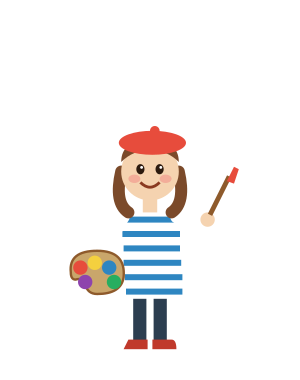
:::
::: {.column width="65%"}
::: {.indice style="font-size: 1.1em;"}
Bonjour ! **Je m'appelle** Pablette.\
**J'ai** 9 **ans**.\
Je suis peintre.\
**J'aime** le rouge et le jaune.\
**Je n'aime pas** le gris !\
Aide-moi, s'il te plaît !
:::

**Et toi ?** Présente-toi : *Je m'appelle… J'ai… ans. J'aime…*
:::
::::

## Les couleurs {#couleurs .smaller}

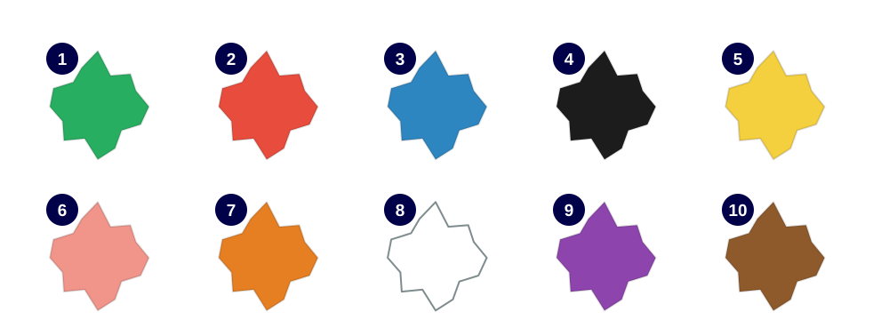{height="340" fig-align="center"}

**Relie** le mot et la couleur.

::: {style="font-size: 1.15em; text-align: center; line-height: 1.8;"}
rouge · bleu · jaune · vert · orange · violet · rose · noir · blanc · marron
:::

## Les suspects {#suspects}

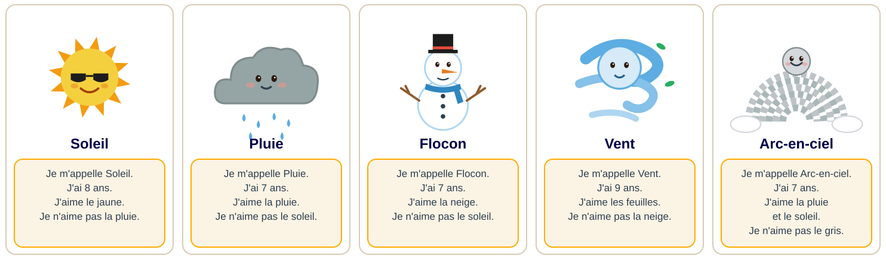{fig-align="center"}

**Lis** les cartes à voix haute.

## Le carnet du détective {#carnet .smaller}

::: {style="font-size: 0.85em;"}
**Complète** ton carnet avec les cartes des suspects.

| Nom | Âge | J'aime 🙂 | Je n'aime pas 🙁 | Barré ? |
|---|---|---|---|---|
| Soleil | | | | |
| Pluie | | | | |
| Flocon | | | | |
| Vent | | | | |
:::

[Je commence l'enquête → diapo @boite](#boite){.choix}

## Mission 1 : la boîte de peinture {#boite .smaller}

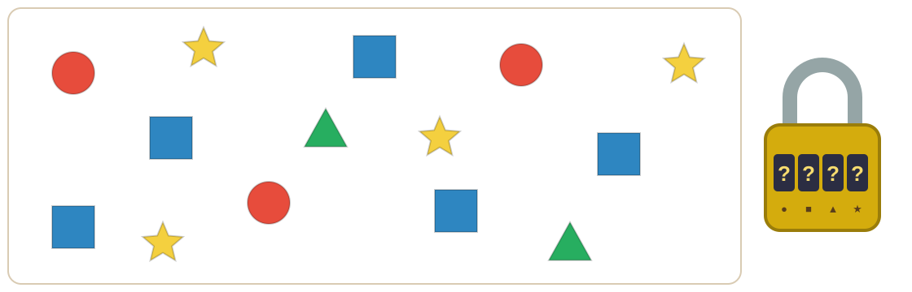{height="300" fig-align="center"}

**Compte** les formes. Le nombre de **cercles**, de **carrés**, de **triangles** et d'**étoiles** ouvre la boîte !

**Le code est…**

[A. 3 – 5 – 2 – 4 → diapo @boite-ouverte](#boite-ouverte){.choix} [B. 4 – 5 – 2 – 3 → diapo @faux-code](#faux-code){.choix} [C. 3 – 4 – 2 – 5 → diapo @faux-code](#faux-code){.choix}

## Oups ! La boîte ne s'ouvre pas {#faux-code}

:::: {.columns}
::: {.column width="55%"}
**Compte encore**, avec ton doigt :

- les **cercles** ● rouges
- les **carrés** ■ bleus
- les **triangles** ▲ verts
- les **étoiles** ★ jaunes

[← Je compte encore → diapo @boite](#boite){.retour}
:::
::: {.column width="45%"}
::: {.callout-tip}
## Rappel : les nombres

1 un · 2 deux · 3 trois\
4 quatre · 5 cinq · 6 six\
7 sept · 8 huit · 9 neuf · 10 dix
:::
:::
::::

## La boîte est ouverte ! {#boite-ouverte}

:::: {.columns}
::: {.column width="45%"}
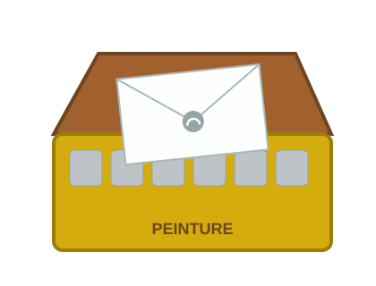
:::
::: {.column width="55%"}
Il n'y a pas de peinture… mais il y a **une lettre** !

Sur la lettre, il y a **un P gris**. 🤔

[Je lis la lettre → diapo @lettre](#lettre){.choix}
:::
::::

## Indice 1 : la lettre {#lettre}

:::: {.columns}
::: {.column width="30%"}
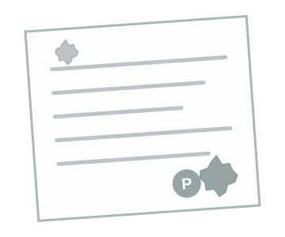
:::
::: {.column width="38%"}
::: {.indice style="font-family: Georgia, serif;"}
Bonjour Pablette,

C'est moi : j'ai les couleurs !\
Je ne suis pas méchante.\
J'ai **7 ans**.\
J'aime **la pluie**.\
Au revoir !

**P.**
:::
:::
::: {.column width="32%"}
**Quel âge a le voleur ?**

[A. 7 ans → diapo @indice-1](#indice-1){.choix}\
[B. 8 ans → diapo @faux-age](#faux-age){.choix}\
[C. 9 ans → diapo @faux-age](#faux-age){.choix}
:::
::::

## Relis bien ! {#faux-age}

:::: {.columns}
::: {.column width="40%"}

:::
::: {.column width="60%"}
La lettre dit : « J'ai **sept** ans. »

::: {style="font-size: 2.4em; font-weight: 800; color: #000149;"}
sept = 7
:::

[← Je relis la lettre → diapo @lettre](#lettre){.retour}
:::
::::

## Indice 1 trouvé ! {#indice-1}

:::: {.columns}
::: {.column width="30%"}

:::
::: {.column width="70%"}
::: {.indice style="font-size: 1.15em; text-align: center;"}
🔎 Le voleur a **7 ans**. Il aime **la pluie**.
:::

Regarde ton carnet. Qui a 7 ans ? **Barre** les autres.

[Continuer → diapo @aimer](#aimer){.choix}
:::
::::

## J'aime, je n'aime pas {#aimer .smaller}

:::: {.columns}
::: {.column width="56%"}
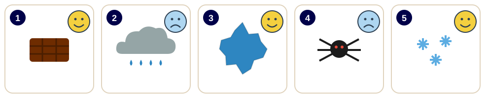{height="120"}

**Complète** avec *J'aime* ou *Je n'aime pas*.

1. 🙂 ________________ le chocolat.
2. 🙁 ________________ la pluie.
3. 🙂 ________________ le bleu.
4. 🙁 ________________ les araignées.
5. 🙂 ________________ la neige.

**Et toi ?** Dis 2 phrases : *J'aime… Je n'aime pas…*

[Continuer → diapo @meteo](#meteo){.choix}
:::
::: {.column width="44%"}
::: {.callout-tip}
## Rappel

🙂 **J'aime** le rouge.

🙁 **Je n'aime pas** le gris.

Attention :\
je + aime → **j'**aime\
je + ai → **j'**ai 7 ans
:::
:::
::::

## Mission 2 : la météo {#meteo .smaller}

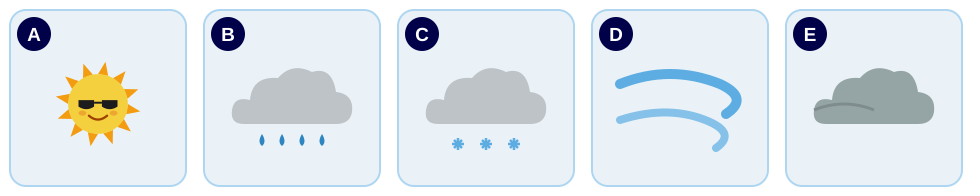{fig-align="center"}

**Relie** l'image et la phrase.

::: {style="font-size: 1.1em; line-height: 1.8;"}
1. Il pleut. · 2. Il fait beau. · 3. Il y a du vent. · 4. Il neige. · 5. Il y a des nuages.
:::

Le voleur aime **la pluie**. **Quelle image ?**

[A. → diapo @faux-meteo](#faux-meteo){.choix} [B. → diapo @indice-2](#indice-2){.choix} [C. → diapo @faux-meteo](#faux-meteo){.choix}

## Regarde bien ! {#faux-meteo}

:::: {.columns}
::: {.column width="40%"}

:::
::: {.column width="60%"}
**La pluie**, c'est de **l'eau** qui tombe du nuage : des petites gouttes **bleues** 💧.

La neige, c'est **blanc** ❄️. Le soleil, c'est **jaune** ☀️.

[← Je regarde encore → diapo @meteo](#meteo){.retour}
:::
::::

## Indice 2 trouvé ! {#indice-2}

:::: {.columns}
::: {.column width="30%"}

:::
::: {.column width="70%"}
::: {.indice style="font-size: 1.15em; text-align: center;"}
🔎 Le voleur aime quand **il pleut**.
:::

Regarde ton carnet. Qui aime la pluie ? Qui n'aime pas la pluie ? **Barre** !

[Continuer → diapo @code](#code){.choix}
:::
::::

## Mission 3 : le message codé {#code .smaller}

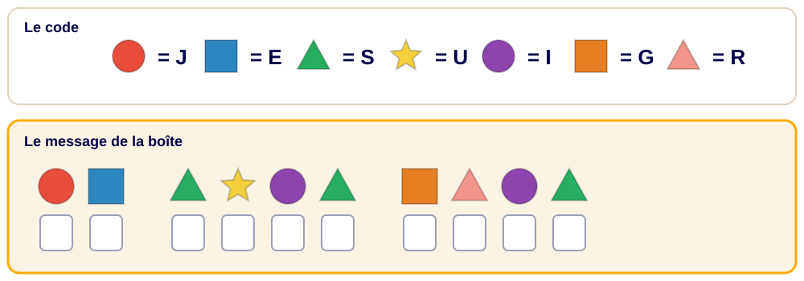{height="360" fig-align="center"}

**Décode** le message : écris une lettre dans chaque case.

[J'ai trouvé ! → diapo @qui](#qui){.choix}

## Qui a volé les couleurs ? {#qui .smaller}

:::: {.columns}
::: {.column width="40%"}
Relis tes indices :

- 🔎 **7 ans** ;
- 🔎 aime **la pluie** ;
- 🔎 « Je suis **grise** ».

**C'est qui ?**

[A. Soleil → diapo @faux-soleil](#faux-soleil){.choix}\
[B. Pluie → diapo @aveux](#aveux){.choix}\
[C. Flocon → diapo @faux-flocon](#faux-flocon){.choix}\
[D. Vent → diapo @faux-vent](#faux-vent){.choix}
:::
::: {.column width="60%"}

:::
::::

## Soleil ? {#faux-soleil}

:::: {.columns}
::: {.column width="40%"}
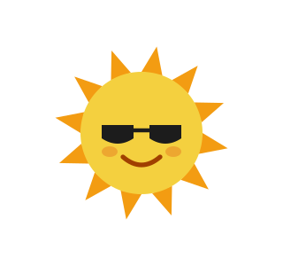
:::
::: {.column width="60%"}
Soleil a **8 ans**. Il **n'aime pas** la pluie. Et il est **jaune** !

[← Je choisis encore → diapo @qui](#qui){.retour}
:::
::::

## Flocon ? {#faux-flocon}

:::: {.columns}
::: {.column width="40%"}
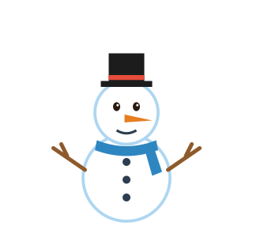
:::
::: {.column width="60%"}
Flocon a bien **7 ans**… mais il aime **la neige**, pas la pluie. Et il est **blanc** !

[← Je choisis encore → diapo @qui](#qui){.retour}
:::
::::

## Vent ? {#faux-vent}

:::: {.columns}
::: {.column width="40%"}

:::
::: {.column width="60%"}
Vent a **9 ans**. Il aime **les feuilles**. Et il est **bleu** !

[← Je choisis encore → diapo @qui](#qui){.retour}
:::
::::

## C'est Pluie ! {#aveux .smaller}

:::: {.columns}
::: {.column width="58%"}
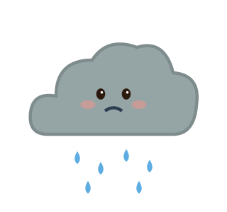{height="160"}

**Complète** la lettre de Pluie avec les mots de la boîte.

::: {style="background:#f7f3ea; padding: 0.5em 1em; font-family: Georgia, serif; line-height: 1.9;"}
Pardon, Pablette !\
Je ______ Pluie.\
J'ai 7 ______.\
Je suis toute ______. Je suis triste !\
J'______ les couleurs.\
Je voulais être ______ comme toi.
:::
:::
::: {.column width="42%"}
::: {.indice}
**La boîte à mots**

ans · aime · grise · m'appelle · colorée
:::

Pablette sourit : « Pas de problème, Pluie ! Avec **la pluie** et **le soleil**, on fait… un **arc-en-ciel** ! »

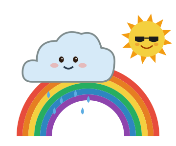{height="190"}
:::
::::

## Dessin : l'arc-en-ciel {#dessin .smaller}

**Écoute** et **dessine** l'arc-en-ciel de Coloria.

::: {.indice style="font-size: 0.95em;"}
Dessine un **arc rouge**. Dessous, un arc **orange**, puis un arc **jaune**, un arc **vert**, un arc **bleu** et un arc **violet**.\
À droite, dessine un **soleil jaune**. À gauche, dessine un **nuage gris** avec **4 gouttes** de pluie.\
En bas, dessine **3 fleurs** : une rouge, une jaune et une violette.
:::

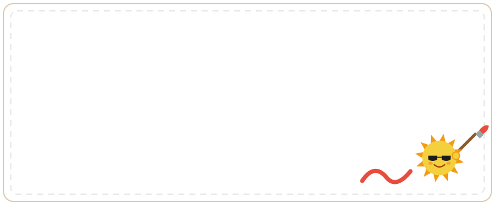{height="300" fig-align="center"}

## Écriture : ma carte d'identité {#ecriture .smaller}

:::: {.columns}
::: {.column width="52%"}
**Écris** ta carte, comme les suspects.

::: {style="background:#f7f3ea; padding: 0.4em 0.9em; font-family: Georgia, serif; line-height: 1.9;"}
Je m'appelle ____________ .J'ai ______ ans.Ma couleur préférée est le ____________ .J'aime ____________ .Je n'aime pas ____________ .Aujourd'hui, il fait ____________ .
:::
:::
::: {.column width="22%"}
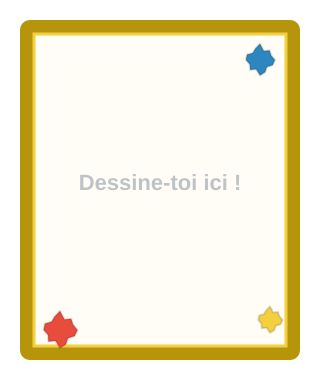
:::
::: {.column width="26%"}
::: {.callout-tip}
## Rappel

**Je m'appelle** Léa.

**J'ai** 8 **ans**.

**J'aime** le vert.

**Je n'aime pas** la neige.
:::
:::
::::

## Bravo ! {.titre-bandeau background-image="img/arc_en_ciel.svg" background-size="contain" background-color="#aed6f1"}

::: {.absolute bottom=14 left=14 width=420 style="background: rgba(255,255,255,.82); color: #1c1c2e; border-radius: 14px; padding: 0.3em 0.7em; font-size: 0.66em;"}
Les couleurs sont revenues à Coloria ! 🌈

Pluie est **contente** : maintenant, elle fait des arcs-en-ciel avec Soleil.
:::
