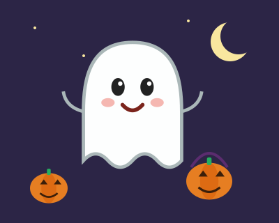
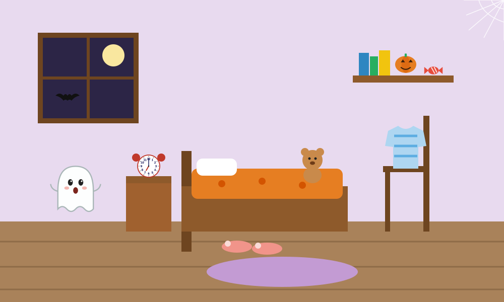
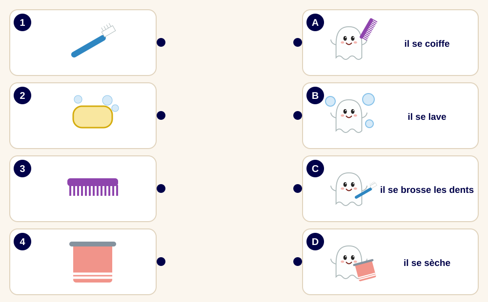
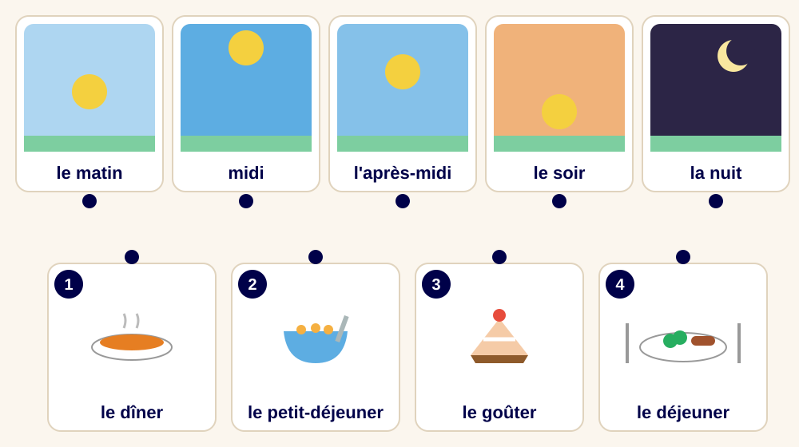
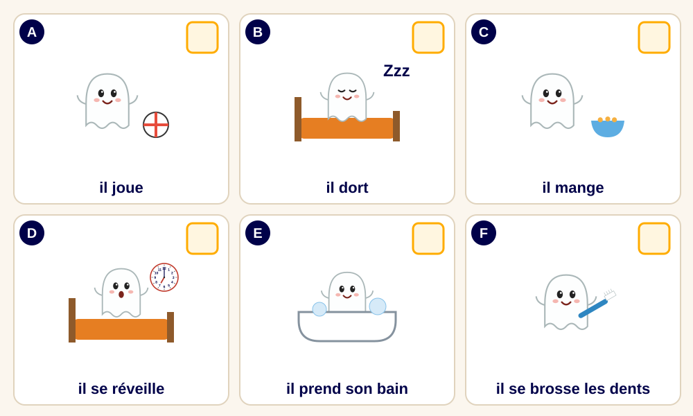
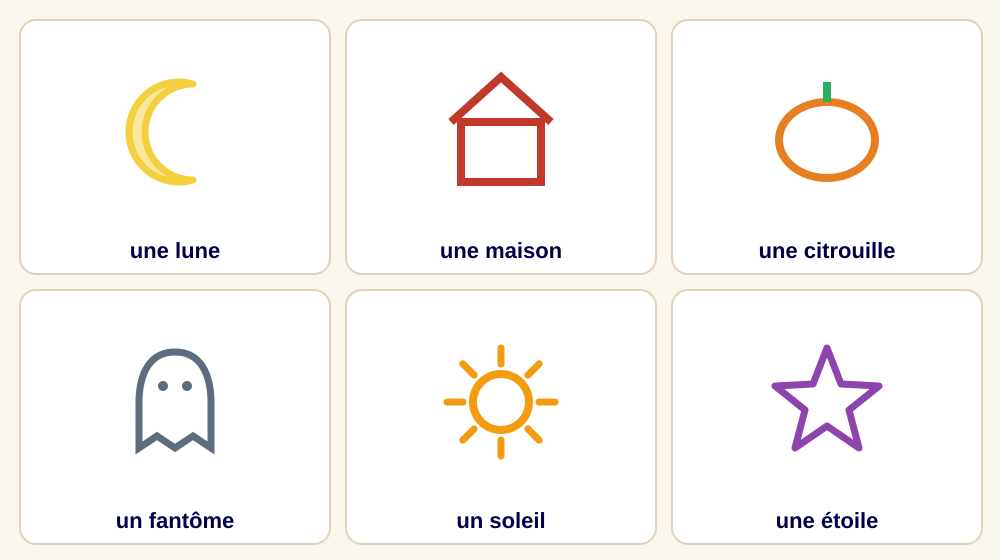
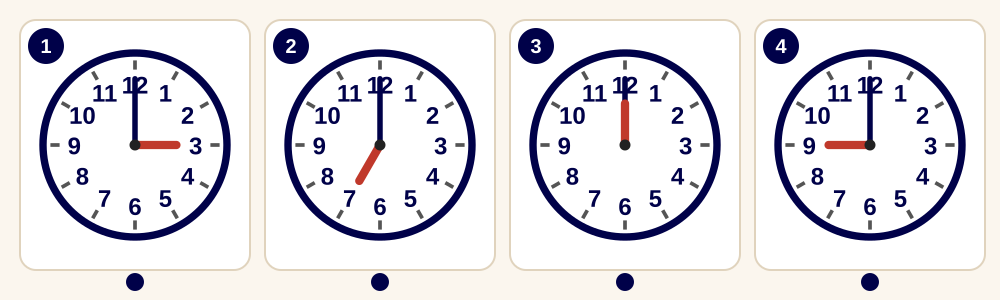
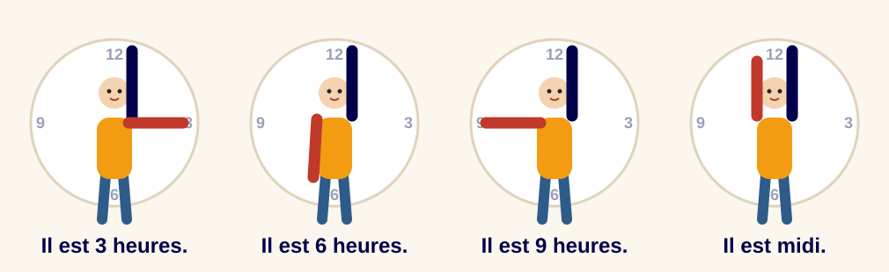
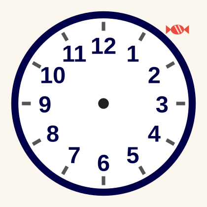
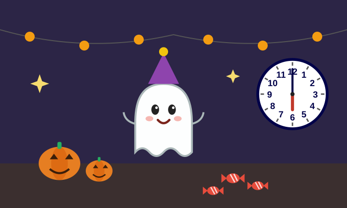

## Boo a un problème !

:::: {.columns}
::: {.column width="52%"}
::: {style="font-size: 1.15em;"}
Voici **Boo**, le petit fantôme.

Ce soir, c'est **la fête d'Halloween** !

Mais… Boo a oublié **l'heure** de la fête !

Aide Boo ! Chaque mission = **1 bonbon** 🍬
:::
:::
::: {.column width="48%"}

:::
::::

::: {.notes}
Lire l'histoire avec beaucoup d'expression. Faire répéter « Boo ! » et « Halloween ! ».
Expliquer : il y a 6 missions, une par pièce. Chaque mission réussie = 1 bonbon. Le nombre de bonbons donnera l'heure de la fête.
Garder un compteur de bonbons au tableau (touche T ou C), ou de vrais bonbons / jetons.
:::

## La maison de Boo {.titre-blanc background-image="img/maison.svg" background-size="contain" background-position="bottom" background-color="#151131"}

::: {.notes}
Nommer les pièces ensemble : la chambre, la salle de bain, la cuisine, le salon, la cave, le grenier.
Jeu : « Montre la cuisine ! » → l'enfant montre du doigt. Puis inverser : l'enfant dit une pièce, le professeur montre.
On va visiter les pièces dans l'ordre des numéros.
:::

## Mission 1 : la chambre 🔍

{height="440" fig-align="center"}

::: {style="font-size: 0.85em;"}
**Cherche et montre :** le réveil · le doudou · le pyjama · les chaussons · la lune · la chauve-souris · **le bonbon !**
:::

::: {.notes}
Le professeur dit un objet, l'enfant le montre (ou l'entoure au stylet, touche C).
Puis demander : « Qu'est-ce que c'est ? » → « C'est un réveil. »
Question bonus : « Le réveil, il sert à quoi ? » → « À se réveiller ! »
Mission réussie quand on a trouvé le bonbon caché sur l'étagère → 1 bonbon.
:::

## Mission 2 : la salle de bain 🔗

{height="480" fig-align="center"}

**Relie** l'objet et l'action.

::: {.notes}
L'enfant relie avec le stylet (touche C) : 1-C (brosse à dents), 2-B (savon), 3-A (peigne), 4-D (serviette).
Faire dire : « Avec la brosse à dents, il se brosse les dents. »
:::

## Mission 2 : Jacques a dit ! 🧍

::: {style="font-size: 1.3em; text-align: center;"}
**Tout le monde debout !**

Jacques a dit… **brosse-toi les dents !**

Jacques a dit… **coiffe-toi !**

Jacques a dit… **lave-toi !**

Jacques a dit… **dors !**
:::

::: {.notes}
Debout ! Le professeur donne l'ordre, les enfants miment. Si on ne dit pas « Jacques a dit », on ne bouge pas.
Ajouter : mange ! joue ! réveille-toi ! sèche-toi ! saute !
Puis un enfant devient « Jacques ».
Mission réussie → 2e bonbon.
:::

## Mission 3 : la cuisine 🔗

{height="470" fig-align="center"}

**Lis** les mots. **Relie** le repas et le moment de la journée.

::: {.notes}
D'abord lire les mots ensemble (le matin, midi, l'après-midi, le soir, la nuit), en montrant le soleil qui bouge.
Puis relier : le petit-déjeuner → le matin, le déjeuner → midi, le goûter → l'après-midi, le dîner → le soir. La nuit → on dort !
Question : « Qu'est-ce que tu manges au petit-déjeuner ? »
Mission réussie → 3e bonbon.
:::

## Mission 4 : le salon 🔢

{height="470" fig-align="center"}

**Remets dans l'ordre** : écris 1, 2, 3… dans les cases.

::: {.notes}
Ordre : 1 D (il se réveille), 2 E (il prend son bain), 3 F (il se brosse les dents), 4 C (il mange), 5 A (il joue), 6 B (il dort).
(D'autres ordres sont possibles pour le bain / les dents / manger : accepter si l'enfant explique.)
Puis raconter : « Le matin, Boo se réveille. Après, il… Le soir, il dort. »
Mission réussie → 4e bonbon.
:::

## Mission 5 : la cave ✋ {.sombre background-image="img/cave.svg" background-size="cover" background-color="#2c2546"}

:::: {.columns}
::: {.column width="38%"}
::: {style="font-size: 1.05em;"}
Oh ! Il fait **tout noir** dans la cave…

On ne voit rien ! On dessine **dans le dos** avec le doigt.

« C'est… une lune ? »
:::
:::
::: {.column width="62%"}

:::
::::

::: {.notes}
Un enfant se retourne. L'autre (ou le professeur) choisit un dessin et le trace lentement avec le doigt dans son dos. L'enfant devine : « C'est une lune ! »
Puis on change de rôle. Commencer par des formes faciles (lune, soleil), puis la maison, l'étoile.
En ligne : l'enfant ferme les yeux, le professeur trace la forme « dans l'air » ou sur la main de l'enfant si un parent est présent ; sinon l'enfant devine au fur et à mesure que le professeur dessine au stylet.
Mission réussie → 5e bonbon.
:::

## Mission 6 : le grenier 🕰️ {.smaller}

{fig-align="center"}

::: {style="font-size: 1.4em; display: flex; justify-content: space-around;"}
**Il est 7 heures.** · **Il est midi.** · **Il est 3 heures.** · **Il est 9 heures.**
:::

**Relie** l'horloge et la phrase.

::: {.notes}
Rappel : la petite aiguille rouge montre l'heure. La grande aiguille bleue est sur le 12.
1 → Il est 3 heures. 2 → Il est 7 heures. 3 → Il est midi. 4 → Il est 9 heures.
Faire dire l'heure à voix haute pour chaque horloge.
:::

## Mission 6 : l'horloge humaine 🧍

{fig-align="center"}

::: {style="font-size: 1.2em; text-align: center;"}
**Debout !** Ton bras bleu, c'est la **grande aiguille**. Ton bras rouge, c'est la **petite aiguille**.
:::

::: {.notes}
Les enfants se mettent debout et deviennent une horloge : un bras levé (la grande aiguille sur 12), l'autre bras montre l'heure.
Le professeur dit : « Il est 3 heures ! », « Il est 9 heures ! », « Il est midi ! », « Il est 6 heures ! »
Puis inverser : un enfant fait l'horloge, l'autre dit l'heure.
Mission réussie → 6e bonbon.
:::

## Combien de bonbons ? 🍬

:::: {.columns}
::: {.column width="55%"}
::: {style="font-size: 1.2em;"}
**Compte** tes bonbons.

J'ai _____ bonbons.

La fête de Boo est à _____ heures !

**Place les aiguilles** sur l'horloge.
:::
:::
::: {.column width="45%"}
{height="440"}
:::
::::

::: {.notes}
6 bonbons → la fête est à 6 heures (le soir).
L'enfant dessine les aiguilles au stylet (touche C) : la petite aiguille sur le 6, la grande sur le 12.
Écrire le chiffre 6 sur la diapo (touche T) ou sur une feuille.
:::

## L'invitation ✏️

::: {style="font-size: 1.25em; background:#fff6e0; border: 4px dashed #FFAC00; border-radius: 18px; padding: 0.6em 1em; text-align: center;"}
**Invitation** 🎃

Viens à la fête de Boo !

C'est **le soir**, à **6 heures**.

Signé : _____________
:::

**Écris** ton prénom. **Dessine** la fête de Boo !

::: {.notes}
Écriture : l'enfant copie son prénom (ou le trace en pointillés préparés par le professeur) et recopie le chiffre 6.
Dessin : chaque enfant dessine la fête sur une feuille (Boo, des citrouilles, des bonbons, l'horloge à 6 heures), puis la présente : « Il y a Boo, il y a… ».
:::

# Joyeux Halloween ! 🎃

{height="420" fig-align="center"}

Bravo ! Grâce à toi, Boo est à l'heure pour sa fête !
