## L'histoire {#histoire .titre-blanc background-image="img/histoire.svg" background-size="contain" background-position="bottom" background-color="#1b1838"}

::: {.absolute bottom=14 left=14 width=540 style="background: rgba(255,255,255,.78); color: #1c1c2e; border-radius: 14px; padding: 0.3em 0.75em; font-size: 0.52em;"}
Frissonville, le soir du 31 octobre. Toutes les lanternes de la ville sont éteintes : à 22 heures, la **Grande Lanterne d'or** doit les rallumer pendant la parade d'Halloween.\
Mais à 21 h 30, au **musée**, la vitrine est **vide** ! Monsieur le Maire a besoin d'un détective. **C'est toi !**

**Attention :** c'est toi qui choisis ton chemin. Réfléchis bien avant de cliquer !
:::

## Les suspects {#suspects}

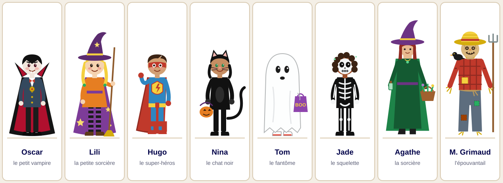{height="440" fig-align="center"}

::: {style="font-size: 0.8em;"}
Regarde bien les suspects. Décris chacun : *Il porte… / Elle a… / Il tient…*
:::

## Le carnet du détective {#carnet .smaller}

::: {style="font-size: 0.72em;"}
Recopie ton carnet. Note les indices et **barre** les suspects.

| Suspect | Enfant ou adulte ? | Une cape ? | Couleur de la cape | Barré ? |
|---|---|---|---|---|
| Oscar, le petit vampire | | | | |
| Lili, la petite sorcière | | | | |
| Hugo, le super-héros | | | | |
| Nina, le chat noir | | | | |
| Tom, le fantôme | | | | |
| Jade, le squelette | | | | |
| Agathe, la sorcière | | | | |
| Monsieur Grimaud, l'épouvantail | | | | |
:::

[Je regarde le plan → diapo @plan](#plan){.choix}

## Le plan de Frissonville {#plan .titre-blanc .titre-petit background-image="img/plan.svg" background-size="contain" background-color="#2b3a2e"}

::: {.absolute top=0 right=8 width=720 style="background: rgba(255,255,255,.78); color: #1c1c2e; border-radius: 10px; padding: 0 0.5em; font-size: 0.38em;"}
Où est le musée ? Quel lieu est **au nord** du parc ? [Je vais voir le maire → diapo @carrefour](#carrefour){.choix}
:::

## Le maire t'attend {#carrefour .smaller}

:::: {.columns}
::: {.column width="55%"}
Tu es devant la **mairie (3)**. Le maire te dit :

::: {.indice}
« Firmin, le boulanger, a vu quelque chose. Au musée, Zélie a tout laissé comme avant. Et la tour de l'horloge… elle est toujours fermée la nuit. »
:::

**Où commences-tu ton enquête ?** Réfléchis : où peux-tu trouver des indices ?

[A. J'interroge le témoin → diapo @itineraire](#itineraire){.choix}\
[B. J'inspecte le musée → diapo @musee](#musee){.choix}\
[C. Je monte dans la tour de l'horloge → diapo @tour-fermee](#tour-fermee){.choix}
:::
::: {.column width="45%"}
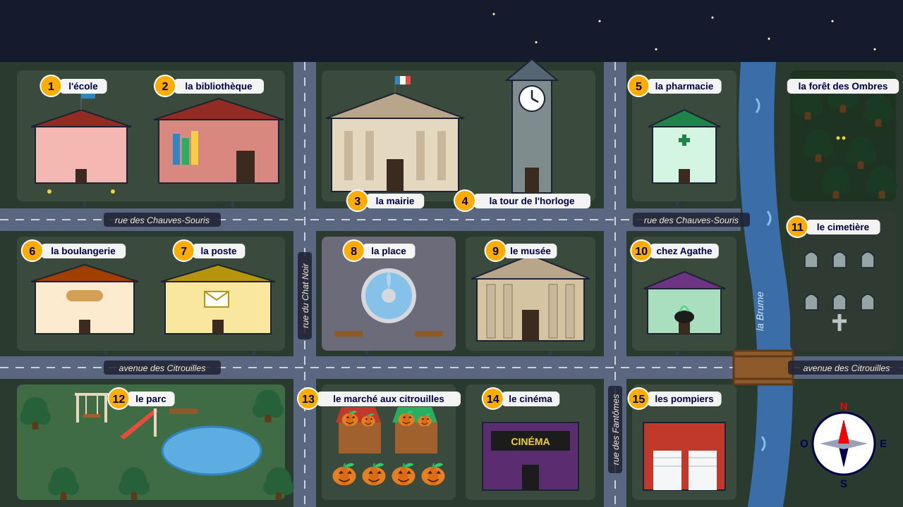
:::
::::

## La tour est fermée ! {#tour-fermee}

:::: {.columns}
::: {.column width="48%"}
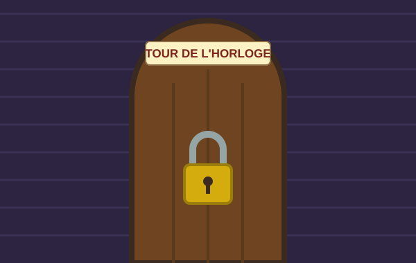
:::
::: {.column width="52%"}
Un gros cadenas ferme la porte. Tu ne peux pas entrer **maintenant**.

Le maire avait raison : la tour est fermée la nuit. Il faut d'abord trouver des **indices**.

[← Retourne voir le maire → diapo @carrefour](#carrefour){.retour}
:::
::::

## Mission 1 : le message du maire {#itineraire .smaller}

:::: {.columns}
::: {.column width="56%"}
Le maire te donne un papier pour trouver le témoin :

::: {.indice style="font-family: Georgia, serif;"}
« Sors de la mairie (3). Prends la **rue des Chauves-Souris** vers l'**ouest**. Traverse la **rue du Chat Noir**. Passe devant la poste. Le bâtiment suivant, **à gauche**, c'est là qu'habite notre premier témoin ! »
:::

Suis le chemin sur le plan avec ton doigt. **Où arrives-tu ?**

[A. À la boulangerie (6) → diapo @boulangerie](#boulangerie){.choix}\
[B. À l'école (1) → diapo @faux-ecole](#faux-ecole){.choix}\
[C. À la bibliothèque (2) → diapo @faux-biblio](#faux-biblio){.choix}
:::
::: {.column width="44%"}

::: {.callout-tip}
## Rappel

**nord** = en haut · **sud** = en bas\
**ouest** = à gauche · **est** = à droite (sur le plan)\
Quand tu marches vers l'ouest, ta **gauche** est au **sud**.
:::
:::
::::

## Oups ! L'école est fermée… {#faux-ecole}

:::: {.columns}
::: {.column width="50%"}
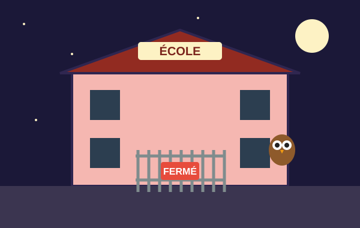
:::
::: {.column width="50%"}
Il n'y a personne ici, seulement un hibou !

L'école est **au nord** de la rue des Chauves-Souris : quand tu marches vers l'ouest, elle est **à droite**.

[← Relis le message → diapo @itineraire](#itineraire){.retour}
:::
::::

## La bibliothèque ? {#faux-biblio}

La bibliothèque est fermée, et elle est **au nord** de la rue : elle est **à droite** quand tu marches vers l'ouest.

Et le message dit : « Passe **devant la poste** ». La poste est au **sud** de la rue !

[← Relis le message → diapo @itineraire](#itineraire){.retour}

## Mission 2 : le témoin de la boulangerie {#boulangerie .titre-petit .titre-bandeau background-image="img/boulangerie.svg" background-size="contain" background-color="#fdf5e6"}

::: {.absolute bottom=14 left=14 width=660 style="background: rgba(255,255,255,.82); color: #1c1c2e; border-radius: 12px; border-left: 6px solid #FFAC00; padding: 0.3em 0.7em; font-size: 0.5em;"}
« Bonsoir, détective ! Ce soir, je **prépare** les gâteaux d'Halloween. À 21 heures, je **regarde** par la fenêtre. Quelqu'un **court** dans la rue ! Il fait nuit, je ne **vois** pas son visage. Mais j'**observe** bien sa **cape** qui vole au vent ! Il **porte** une grande lumière dorée dans les mains. » *Firmin, le boulanger*

[J'ai lu le témoignage → diapo @question-boulangerie](#question-boulangerie){.choix}
:::

## Mission 2 : la question {#question-boulangerie .smaller}

:::: {.columns}
::: {.column width="50%"}
1. À quelle heure Firmin a-t-il vu quelqu'un ?
2. Que faisait Firmin ce soir-là ?
3. Que portait la personne dans les mains ?

**Quel vêtement du voleur Firmin a-t-il vu ?**

[A. Une cape → diapo @indice-1](#indice-1){.choix}\
[B. Un tablier blanc → diapo @faux-tablier](#faux-tablier){.choix}\
[C. Un chapeau pointu → diapo @faux-chapeau](#faux-chapeau){.choix}
:::
::: {.column width="50%"}
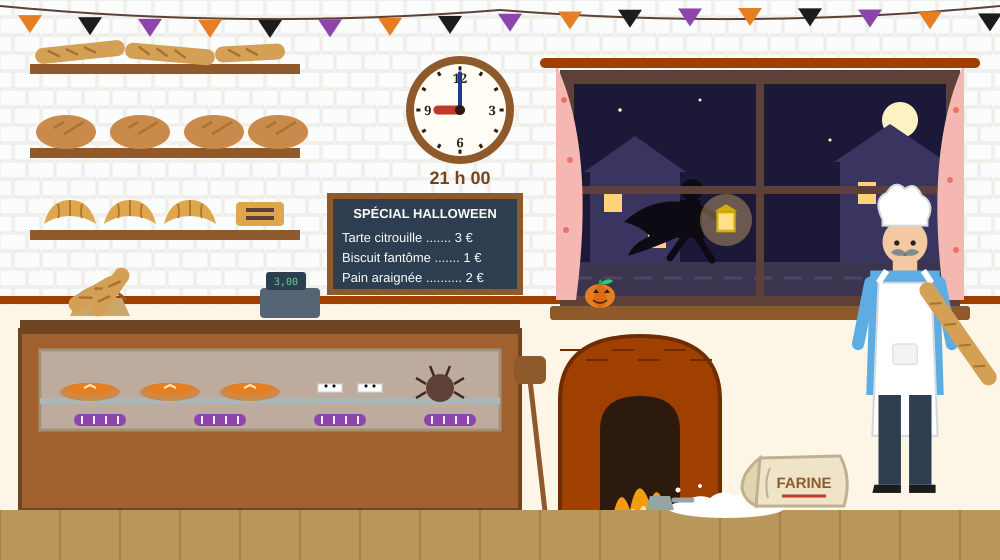
:::
::::

## Fausse piste : le tablier {#faux-tablier}

Le tablier blanc, c'est le vêtement de **Firmin** lui-même !

Relis le témoignage : quel vêtement **vole au vent** ?

[← Relis le témoignage → diapo @boulangerie](#boulangerie){.retour}

## Fausse piste : le chapeau {#faux-chapeau}

Firmin ne parle **pas** de chapeau ! Il dit : « Je ne vois pas son visage. »

Un détective n'invente rien : il note seulement ce que le témoin a **vraiment** dit.

[← Relis le témoignage → diapo @boulangerie](#boulangerie){.retour}

## Indice 1 trouvé ! {#indice-1}

::: {.indice style="font-size: 1.15em; text-align: center;"}
🔎 **Le voleur porte une cape.**
:::

Regarde les suspects (diapo @suspects). Qui **ne porte pas** de cape ? **Barre**-les sur ton carnet.

Attention : Nina est habillée tout en noir… mais a-t-elle une cape ?

[Continuer → diapo @conjugaison](#conjugaison){.choix}

## Conjugaison : le présent {#conjugaison .smaller}

:::: {.columns}
::: {.column width="56%"}
Dans le témoignage de Firmin, **souligne** les verbes au présent.

Puis **conjugue** au présent :

1. Firmin (préparer) ________ les gâteaux.
2. Les enfants (regarder) ________ la parade.
3. Nous (être) ________ détectives.
4. Tu (avoir) ________ une loupe.
5. Vous (chercher) ________ la lanterne.
6. Je (marcher) ________ dans la rue.

**As-tu déjà inspecté le musée ?**\
[Non → diapo @musee](#musee){.choix} [Oui → diapo @soupcons](#soupcons){.choix}
:::
::: {.column width="44%"}
::: {.callout-tip}
## Rappel

**Verbes en -er** (comme *regarder*)

| | |
|---|---|
| je regard**e** | nous regard**ons** |
| tu regard**es** | vous regard**ez** |
| il, elle regard**e** | ils, elles regard**ent** |

**être** : je suis, tu es, il est, nous sommes, vous êtes, ils sont

**avoir** : j'ai, tu as, il a, nous avons, vous avez, ils ont
:::
:::
::::

## Mission 3 : la scène du musée {#musee .titre-petit .titre-bandeau background-image="img/musee.svg" background-size="contain" background-color="#d9c8b4"}

::: {.absolute top=0 right=4 width=600 style="background: rgba(255,255,255,.78); color: #1c1c2e; border-radius: 10px; padding: 0 0.4em; font-size: 0.36em;"}
**Entoure :** la vitrine · la fenêtre · l'horloge · les empreintes · le bonbon · le fil noir [Suite → diapo @question-musee](#question-musee){.choix}
:::

## Mission 3 : la question {#question-musee .smaller}

:::: {.columns}
::: {.column width="55%"}
1. À quelle heure la lanterne a-t-elle disparu ? Regarde l'horloge.
2. Par où le voleur est-il sorti ?
3. De quelle couleur est le fil accroché à la fenêtre ?

**Regarde les empreintes. Comment sont-elles ?**

[A. Petites (pieds d'enfant) → diapo @indice-2](#indice-2){.choix}\
[B. Grandes (pieds d'adulte) → diapo @faux-musee](#faux-musee){.choix}\
[C. Je ne sais pas, je mesure → diapo @faux-musee](#faux-musee){.choix}
:::
::: {.column width="45%"}
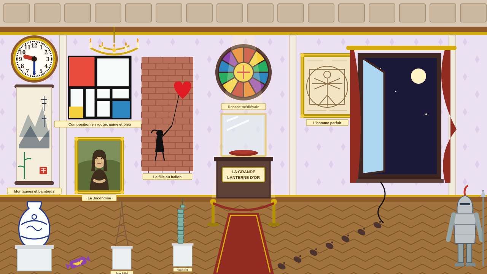
:::
::::

## Mesurons ! {#faux-musee .smaller}

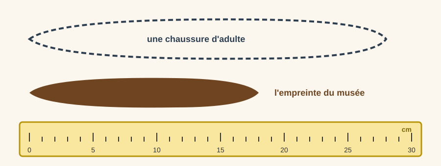{height="290" fig-align="center"}

Pose l'empreinte sur la règle. Elle mesure environ ______ cm. Une chaussure d'adulte mesure environ ______ cm.

Alors, l'empreinte est-elle grande ou petite ?

[← Retourne à la question → diapo @question-musee](#question-musee){.retour}

## Indice 2 trouvé ! {#indice-2}

::: {.indice style="font-size: 1.15em; text-align: center;"}
🔎 **Les empreintes sont petites : le voleur est un enfant.**\
**Et le fil accroché à la fenêtre est noir.**
:::

**Barre** les adultes. Puis regarde la **couleur des capes** : barre les capes qui ne sont pas noires.

[Continuer → diapo @grammaire](#grammaire){.choix}

## Grammaire : le pluriel des noms {#grammaire .smaller}

:::: {.columns}
::: {.column width="56%"}
Au musée, il y a beaucoup d'objets ! **Écris au pluriel.**

1. un tableau → des ____________
2. une vitrine → des ____________
3. un bijou → des ____________
4. un journal → des ____________
5. une lanterne → des ____________
6. un chapeau → des ____________
7. un animal → des ____________
8. un hibou → des ____________

**As-tu déjà interrogé le témoin ?**\
[Non → diapo @itineraire](#itineraire){.choix} [Oui → diapo @soupcons](#soupcons){.choix}
:::
::: {.column width="44%"}
::: {.callout-tip}
## Rappel

En général, on ajoute **-s** :\
*une vitrine → des vitrine**s***

Les noms en **-eau** et **-eu** prennent **-x** :\
*un tableau → des tableau**x***

Les noms en **-al** font **-aux** :\
*un journal → des journ**aux***

7 noms en **-ou** prennent **-x** :\
bijou, caillou, chou, genou, **hibou**, joujou, pou
:::
:::
::::

## Qui soupçonnes-tu ? {#soupcons .smaller}

:::: {.columns}
::: {.column width="55%"}
Relis tes indices : le voleur porte **une cape**, c'est **un enfant**, et un fil **noir** est resté à la fenêtre.

**Qui vas-tu interroger ?**

[A. Agathe, la sorcière → diapo @chez-agathe](#chez-agathe){.choix}\
[B. Oscar, le petit vampire → diapo @dessin](#dessin){.choix}\
[C. Hugo, le super-héros → diapo @faux-hugo](#faux-hugo){.choix}\
[D. Nina, le chat noir → diapo @faux-nina](#faux-nina){.choix}
:::
::: {.column width="45%"}

:::
::::

## Chez Agathe {#chez-agathe .smaller}

:::: {.columns}
::: {.column width="50%"}
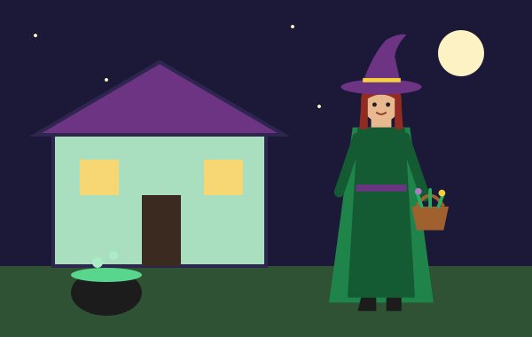
:::
::: {.column width="50%"}
Agathe ouvre la porte :

::: {.indice}
« Une cape ? Oui, j'ai une grande cape **verte**. Mais ce soir, j'étais au marché aux citrouilles jusqu'à 22 heures ! Et regarde mes pieds : je suis une **adulte**. »
:::

Agathe porte une cape, mais elle est **verte**, et elle est **adulte**. Est-ce que ça correspond à tes indices ?

[← Je choisis un autre suspect → diapo @soupcons](#soupcons){.retour}
:::
::::

## Hugo, le super-héros {#faux-hugo}

Hugo est bien un **enfant**, et il porte une **cape**… mais regarde sa couleur : elle est **rouge** !

Le fil trouvé au musée est **noir**.

[← Je choisis un autre suspect → diapo @soupcons](#soupcons){.retour}

## Nina, le chat noir {#faux-nina}

Nina est un **enfant** et elle est habillée tout en **noir**… mais elle ne porte **pas de cape** ! Elle a seulement une queue de chat.

Souviens-toi de l'indice 1 : Firmin a vu une **cape** voler au vent.

[← Je choisis un autre suspect → diapo @soupcons](#soupcons){.retour}

## Dessin guidé : la Grande Lanterne d'or {#dessin .smaller}

Pour retrouver la lanterne, il faut bien la connaître ! Zélie la décrit. **Écoute et dessine**, étape par étape.

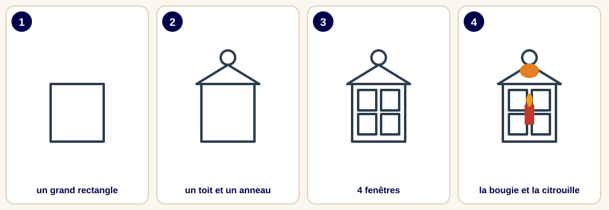{fig-align="center"}

*« Elle a la forme d'une petite maison. Elle a un toit pointu avec un anneau. Elle a quatre fenêtres. Au milieu, il y a une bougie rouge. Sur le toit, il y a une petite citrouille. »*

Zélie ajoute : « J'ai vu Oscar monter dans la **tour de l'horloge**. Voici la **clé** ! »

[Je monte dans la tour → diapo @tour](#tour){.choix}

## Mission 4 : la tour de l'horloge {#tour .titre-blanc background-image="img/tour.svg" background-size="contain" background-color="#2c2440"}

::: {.absolute bottom=20 left=20 width=620 style="background: rgba(255,255,255,.78); color: #1c1c2e; border-radius: 14px; padding: 0.35em 0.8em; font-size: 0.6em;"}
Avec la clé de Zélie, tu ouvres la tour. Sur le mur, un **papier** est punaisé. Et dans l'escalier… des **petites lumières dorées** !\
[Je lis le papier → diapo @code](#code){.choix}
:::

## Mission 4 : le message codé {#code .smaller}

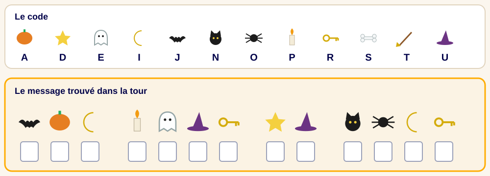{height="340" fig-align="center"}

**Décode** le message. Puis réfléchis : **qui a pu l'écrire ?**

[A. Oscar → diapo @question-finale](#question-finale){.choix}
[B. Agathe → diapo @faux-code](#faux-code){.choix}
[C. Monsieur Grimaud → diapo @faux-code](#faux-code){.choix}

## Qui a peur du noir ? {#faux-code}

Agathe habite à côté de la **forêt des Ombres** et Monsieur Grimaud, déguisé en épouvantail, passe ses nuits dans les champs avec son corbeau : ils n'ont pas peur du noir !

Et souviens-toi : le voleur est un **enfant** avec une cape **noire**.

[← Relis le message → diapo @code](#code){.retour}

## Mission 5 : où est la lanterne ? {#question-finale .smaller}

:::: {.columns}
::: {.column width="76%"}
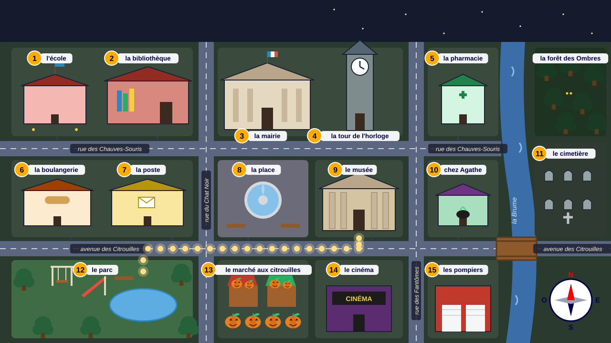
:::
::: {.column width="24%"}
Des **lumières dorées** sont apparues !

Pars du **musée (9)** et suis-les avec ton doigt.

**Où vont-elles ?**

[A. Au parc (12) → diapo @aveux](#aveux){.choix}
[B. Au cimetière (11) → diapo @faux-cimetiere](#faux-cimetiere){.choix}
[C. À la place (8) → diapo @faux-place](#faux-place){.choix}
:::
::::

## Brrr… le cimetière ! {#faux-cimetiere}

:::: {.columns}
::: {.column width="50%"}
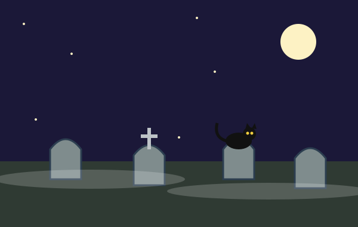
:::
::: {.column width="50%"}
Il n'y a qu'un chat noir et du brouillard…

Les lumières ne traversent pas la rivière ! Elles partent du musée, descendent vers l'**avenue des Citrouilles**, puis vont vers l'**ouest**.

[← Regarde encore le plan → diapo @question-finale](#question-finale){.retour}
:::
::::

## La place ? {#faux-place}

Les lumières **passent** devant la place, sur l'avenue des Citrouilles… mais elles **continuent** vers l'ouest !

Suis-les jusqu'au **bout** : où tournent-elles ?

[← Regarde encore le plan → diapo @question-finale](#question-finale){.retour}

## Les aveux d'Oscar {#aveux .titre-blanc background-image="img/parc.svg" background-size="contain" background-position="bottom" background-color="#1b1838"}

::: {.absolute top=110 left=20 width=520 style="background: rgba(255,255,255,.78); color: #1c1c2e; border-radius: 14px; padding: 0.4em 0.85em; font-size: 0.6em;"}
« C'est moi… Je suis un petit vampire, mais… **j'ai peur du noir** ! Ce soir, toutes les rues étaient sombres. Au musée, la lanterne brillait si fort ! Je l'ai prise pour aller au parc retrouver mes amis. Pardon, monsieur le Maire. »

Le maire sourit : « Tu sais quoi, Oscar ? Ce soir, c'est **toi** qui porteras la lanterne en tête de la parade ! »
:::

## À l'oral : interroge Oscar {#oral .smaller}

:::: {.columns}
::: {.column width="56%"}
Un élève joue **Oscar**, un autre joue le **détective**.

**Le détective pose 3 questions :**

- une question avec **Pourquoi** … ?
- une question avec **Où** … ?
- une question avec **Est-ce que** … ?

**Oscar répond** avec une phrase complète.

**Et toi ?** De quoi as-tu peur ? Qu'est-ce qui te rassure ?
:::
::: {.column width="44%"}
::: {.callout-tip}
## Rappel

Une question commence par une **majuscule** et finit par un **point d'interrogation** ( ? ).

À l'oral, **la voix monte** à la fin :\
*Tu as peur du noir* ↗ ?

*Pourquoi as-tu pris la lanterne ?*\
*Où étais-tu à 21 heures ?*\
*Est-ce que tu as peur ?*
:::
:::
::::

## Écriture créative : ma lanterne magique {#ecriture .smaller}

:::: {.columns}
::: {.column width="56%"}
Invente **ta propre lanterne magique** pour la parade. Écris **6 à 8 lignes**.

- Quelle est sa **forme** ? Ses **couleurs** ?
- Qu'est-ce qu'il y a **dedans** ?
- Quel est son **pouvoir magique** ?
- Qui la porte pendant la parade ?

Puis **dessine-la** !
:::
::: {.column width="44%"}
::: {.indice}
**Pour réussir**

☐ j'écris des phrases avec une majuscule et un point\
☐ j'utilise au moins 3 adjectifs (*brillant, doré, magique…*)\
☐ j'utilise *d'abord, ensuite, enfin*\
☐ je relis mon texte
:::
:::
::::

# Bravo, détective !

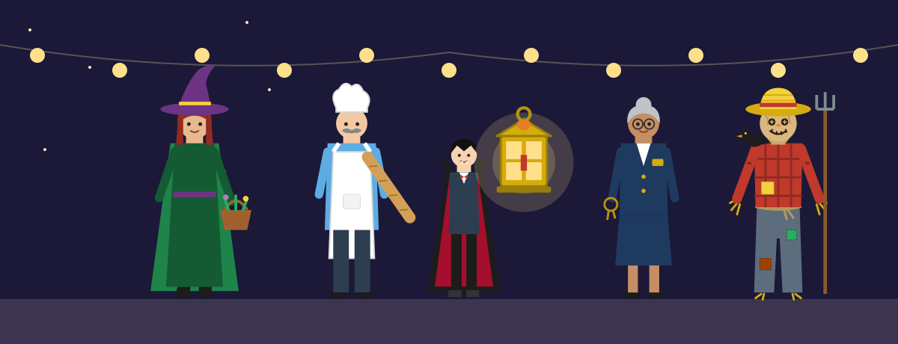{fig-align="center"}

La Grande Lanterne d'or est retrouvée. Joyeux Halloween à Frissonville !
