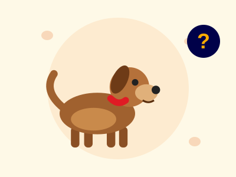
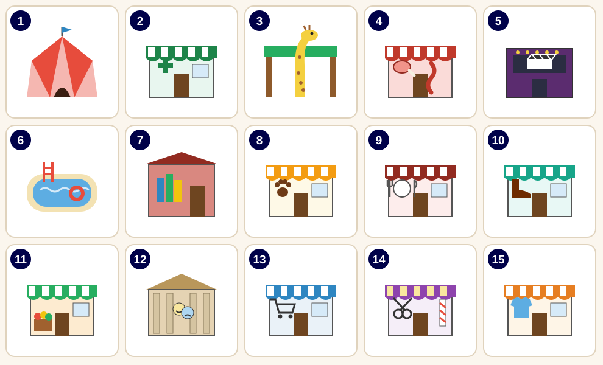
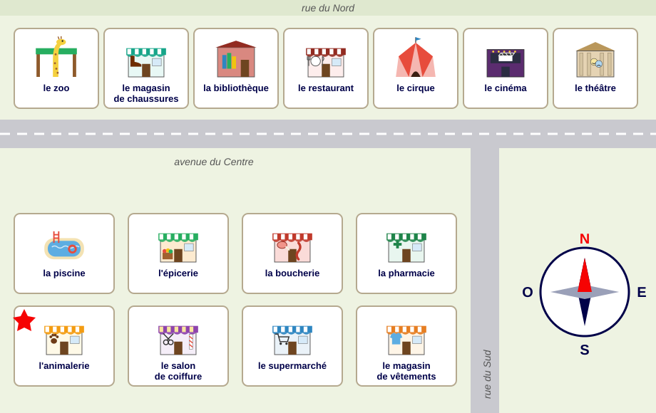
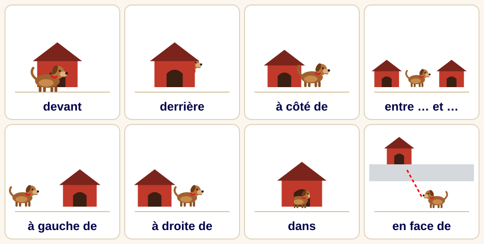
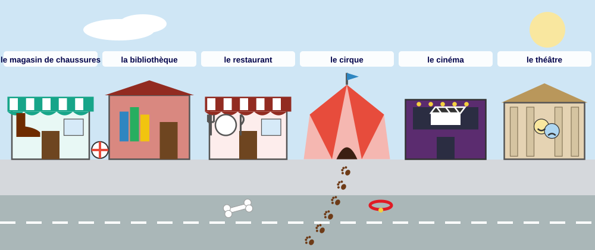
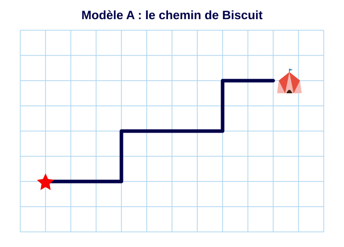
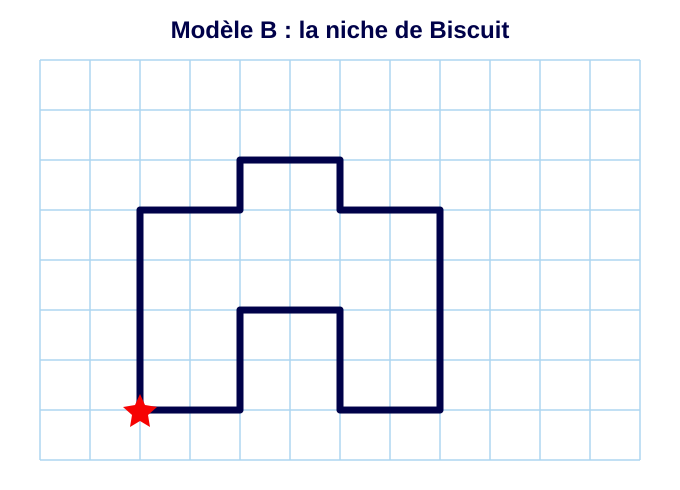
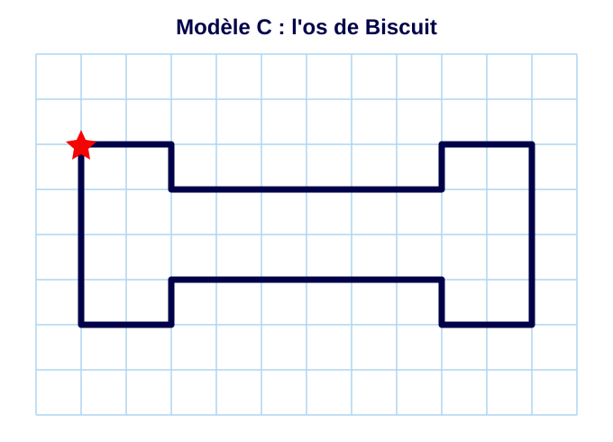

## L'histoire

:::: {.columns}
::: {.column width="55%"}
C'est samedi matin.

Madame Rosa travaille à **l'animalerie**.

Oh non ! La porte est ouverte… **Biscuit**, son petit chien, n'est pas là !

Biscuit est perdu dans la ville.

**Aide Madame Rosa à trouver Biscuit !**
:::
::: {.column width="45%"}

:::
::::

## Les lieux de la ville {.smaller}

:::: {.columns}
::: {.column width="64%"}

:::
::: {.column width="36%"}
**Relie** le mot et l'image.

::: {style="font-size: 0.66em;"}
a. une animalerie\
b. une bibliothèque\
c. une boucherie\
d. un cinéma\
e. un cirque\
f. une épicerie\
g. un magasin de chaussures\
h. un magasin de vêtements\
i. une pharmacie\
j. une piscine\
k. un restaurant\
l. un salon de coiffure\
m. un supermarché\
n. un théâtre\
o. un zoo
:::
:::
::::

## Je vais au… / à la… {.smaller}

:::: {.columns}
::: {.column width="55%"}
**Souligne** la bonne réponse.

1. Je vais **(au / à la)** piscine.
2. Je vais **(au / à la)** cinéma.
3. Je vais **(au / à la)** zoo.
4. Je vais **(au / à la)** bibliothèque.
5. Je vais **(au / à l')** épicerie.
6. Je vais **(au / à la)** restaurant.
:::
::: {.column width="45%"}
::: {.callout-tip}
## Rappel

| | | |
|---|---|---|
| **le** cinéma | → | Je vais **au** cinéma. |
| **la** piscine | → | Je vais **à la** piscine. |
| **l'**épicerie | → | Je vais **à l'**épicerie. |

à + le = **au**
:::
:::
::::

## La fiche d'enquête

::: {style="font-size: 0.8em;"}
Biscuit est dans un de ces lieux. À chaque indice, **barre** les lieux où Biscuit **n'est pas**.

| | | |
|---|---|---|
| ☐ la piscine | ☐ le salon de coiffure | ☐ la bibliothèque |
| ☐ l'épicerie | ☐ le restaurant | ☐ le cirque |
| ☐ la boucherie | ☐ le supermarché | ☐ le cinéma |
| ☐ la pharmacie | ☐ le magasin de chaussures | ☐ le zoo |
| ☐ l'animalerie | ☐ le magasin de vêtements | ☐ le théâtre |
:::

## Indice 1 : l'affiche

:::: {.columns}
::: {.column width="55%"}
::: {.indice style="font-size: 0.8em;"}
**CHIEN PERDU !**

Il s'appelle **Biscuit**.\
C'est un petit chien marron.\
Il a un collier rouge.

Il aime les os, les ballons et la musique.\
Il n'aime pas l'eau.\
Il a peur des grands animaux.

Appelez Madame Rosa : **06 72 85 91 40**
:::
:::
::: {.column width="45%"}

:::
::::

## Indice 1 : exercices {.smaller}

1. **Souligne** en vert ce que Biscuit **aime**. **Souligne** en rouge ce qu'il **n'aime pas**.

2. **Vrai** ou **faux** ? Coche.

| | Vrai | Faux |
|---|:---:|:---:|
| Biscuit est un grand chien. | ☐ | ☐ |
| Biscuit a un collier rouge. | ☐ | ☐ |
| Biscuit aime l'eau. | ☐ | ☐ |

3. **Complète**, puis **barre** sur la fiche.\
   Biscuit n'aime pas l'eau → il n'est pas à la ____________ .\
   Biscuit a peur des grands animaux → il n'est pas au ____________ .

4. Lis le numéro de téléphone à voix haute : 06 72 85 91 40.

## Indice 2 : le plan de la ville

:::: {.columns}
::: {.column width="64%"}

:::
::: {.column width="36%"}
Madame Rosa reçoit un message :

::: {.indice style="font-size: 0.85em;"}
Bonjour Madame Rosa ! J'ai vu un petit chien marron avec un collier rouge. Il est **au nord** de la ville !\
*Paul*
:::
:::
::::

## Indice 2 : exercices {.smaller}

:::: {.columns}
::: {.column width="58%"}
1. Regarde la rose des vents. Le nord est **(en haut / en bas)**.

2. **Souligne** la bonne réponse.
   - Le cirque est **(au nord / au sud)**.
   - La piscine est **(au nord / au sud)**.
   - L'animalerie est **(au nord / au sud)**.
   - Le zoo est **(au nord / au sud)**.

3. Biscuit est **au nord**. **Barre** les lieux du sud.\
   Combien de lieux restent sur ta fiche ? ______
:::
::: {.column width="42%"}
::: {.callout-tip}
## Rappel

- **au** nord
- **au** sud
- **à l'**est
- **à l'**ouest

*Le cirque est **au nord** de la ville.*
:::
:::
::::

## Pour dire où

{height="500" fig-align="center"}

Où est Biscuit ? Dis une phrase pour chaque image : *Biscuit est **devant** la niche.*

## Indice 3 : la rue du Nord

{height="440" fig-align="center"}

**Trouve** et **entoure** dans l'image : un os · un ballon · le collier de Biscuit · les traces de pattes

## Indice 3 : exercices {.smaller}

:::: {.columns}
::: {.column width="58%"}
**Souligne** la bonne réponse.

1. L'os est **(devant / derrière)** le restaurant.
2. Le ballon est **(à côté de / dans)** la bibliothèque.
3. Le collier est **(devant / sur)** le cirque.
4. Le cinéma est **(à gauche / à droite)** du cirque.
5. Le restaurant est **(entre / dans)** la bibliothèque et le cirque.
6. Les traces de pattes vont **(dans / derrière)** le cirque.

**Où est Biscuit ?** Il est au ______________ !
:::
::: {.column width="42%"}

:::
::::

## Dessin : la dictée sur feuille à carreaux {.smaller}

:::: {.columns}
::: {.column width="55%"}
Une élève **explique**, une élève **dessine** sans regarder l'écran, une élève **vérifie**.

| | explique | dessine | vérifie |
|---|---|---|---|
| **Tour 1** (modèle A) | A | B | C |
| **Tour 2** (modèle B) | B | C | A |
| **Tour 3** (modèle C) | C | A | B |

Après chaque tour, on compare le dessin et le modèle.
:::
::: {.column width="45%"}
::: {.indice}
**Les phrases pour expliquer**

- Commence sur l'**étoile**.
- Va **à droite** de ... carreaux.
- Va **à gauche** de ... carreaux.
- **Monte** de ... carreaux.
- **Descends** de ... carreaux.
- Stop !
:::
:::
::::

## Tour 1 : modèle A (B ne regarde pas !)

{height="560" fig-align="center"}

## Tour 2 : modèle B (C ne regarde pas !)

{height="560" fig-align="center"}

## Tour 3 : modèle C (A ne regarde pas !)

{height="560" fig-align="center"}

## Écriture : le message à Madame Rosa {.smaller}

:::: {.columns}
::: {.column width="62%"}
**Complète** le message avec les mots de la boîte.

::: {style="background:#f7f3ea; padding: 0.5em 1em; font-family: Georgia, serif; line-height: 1.8;"}
Bonjour Madame Rosa,\
J'ai trouvé Biscuit ! Il est __________ cirque.\
Le cirque est au __________ de la ville.\
Il est entre le __________ et le __________ .\
Le collier rouge est __________ le cirque.\
À bientôt !\
__________ (ton prénom)
:::
:::
::: {.column width="38%"}
::: {.indice}
**La boîte à mots**

au · nord · restaurant · cinéma · devant
:::

**Bonus :** écris une phrase de plus.\
*Biscuit aime ...*
:::
::::

# Biscuit est retrouvé !

{height="380" fig-align="center"}

Bravo, détectives ! Biscuit voulait devenir une star du cirque.
