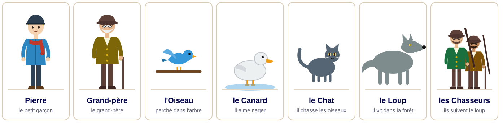
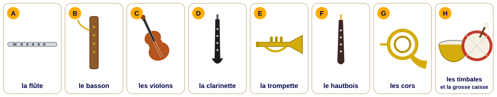
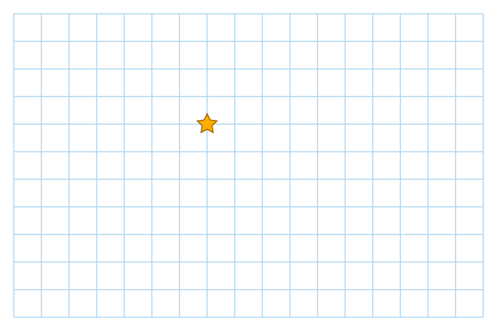
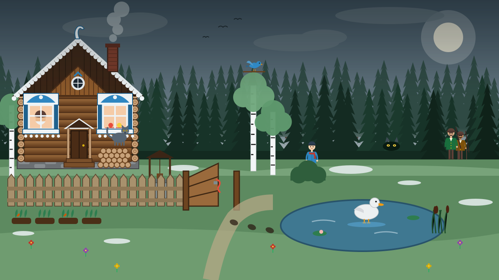
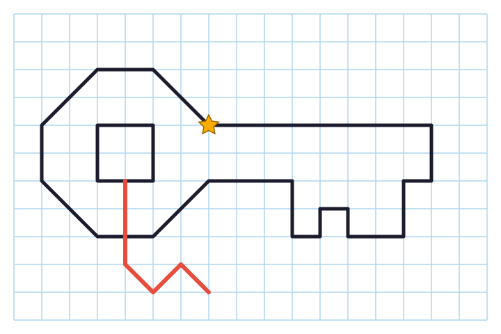
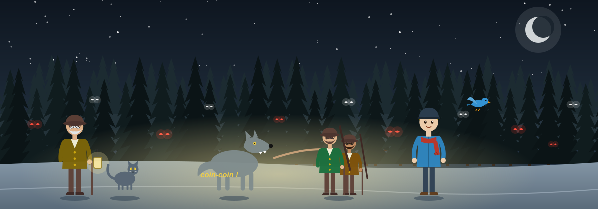

## L'affaire {.titre-bandeau background-image="img/prairie.svg" background-size="contain" background-color="#3d4f5c"}

::: {.absolute top=8 right=-40 width=540 style="background: rgba(255,255,255,.62); color: #1c1c2e; border-radius: 14px; padding: 0.2em 0.6em; font-size: 0.42em;"}
« Ils discutèrent longtemps, le canard nageant dans la mare, le petit oiseau voltigeant au bord. […] Un gros loup gris sortit de la forêt. Le canard se précipita hors de la mare en caquetant. Mais malgré tous ses efforts, le loup courait plus vite. »

« Et maintenant voici où en étaient les choses : le chat était assis sur une branche, l'oiseau sur une autre, tandis que le loup faisait le tour de l'arbre et les regardait tous deux avec des yeux gourmands. »

Mais le grand-père veut savoir : **qui a laissé le portail ouvert ?**

::: {style="font-size: 0.55em; color: #1c1c2e;"}
Extraits de *Pierre et le Loup*, texte de Sergueï Prokofiev ([Philharmonie de Paris](https://drop.philharmoniedeparis.fr/CMDP/CMDP000009500/Pierre-et-le-Loup-texte-integral.pdf)).
:::
:::

## Les personnages

{fig-align="center"}

Présenter chaque personnage : son caractère, ce qu'il aime, ce qu'il craint. Selon vous, qui est le plus **imprudent** ? le plus **courageux** ?

## Le carnet d'enquête {.smaller}

::: {style="font-size: 0.85em;"}
À chaque indice, barrer les suspects.

| Suspect | Son instrument | Où à 8 h ? | Alibi | Innocent ? |
|---|---|---|---|---|
| Pierre | | | | |
| le grand-père | | | | |
| l'oiseau | | | | |
| le canard | | | | |
| le chat | | | | |
| le loup | | | | |
| les chasseurs | | | | |
:::

## Indice 1 : à chaque personnage, son instrument {.smaller}

{fig-align="center"}

Dans *Pierre et le Loup* (1936), **Sergueï Prokofiev** fait entendre chaque personnage par un instrument de l'orchestre.

**Écouter** le conte et **associer** chaque personnage à son instrument : Pierre · l'oiseau · le canard · le chat · le grand-père · le loup · les chasseurs · les coups de feu.

**Trouver** la famille correspondante : les bois, les cuivres, les percussions, les cordes

🎧 [Écouter *Pierre et le Loup* sur YouTube](https://www.youtube.com/watch?v=eAqSYmtWAe8)

## Indice 1 : l'enregistrement {.smaller}

:::: {.columns}
::: {.column width="58%"}
Le magnétophone du grand-père était allumé près de la fenêtre. Voici ce qu'on entend à 8 heures, près du portail :

::: {.indice style="font-size: 0.9em;"}
🎻 d'abord les violons, joyeux et rapides…\
🎶 puis le hautbois, qui s'éloigne vers la mare…\
🐦 et, au-dessus, la flûte, qui gazouille.

À 9 heures seulement, on entend les cors, graves et menaçants.\
Vers 10 heures, enfin, arrivent la trompette et les timbales.
:::

:::
::: {.column width="42%"}
\
\

1. Quels personnages étaient près du portail à 8 heures ?
2. Quels instruments n'entend-on pas ? Qu'en concluez-vous ?
3. Pourquoi le loup et les chasseurs ne peuvent-ils pas être coupables ?

**Barrer** les suspects.
:::
::::

## Indice 2 : le livre de Prokofiev {.smaller}

::: {style="font-size: 0.86em;"}
::: {style="font-style: italic; color: #451963; margin: 0.25em 0;"}
Le grand-père ouvre le livre de Prokofiev et lit à voix haute ce qui s'est passé ce matin-là. Mais attention : une tache d'encre a effacé certains mots…
:::

::: {style="font-family: Georgia, serif; background: #fbf3e4; border-left: 6px solid #FFAC00; padding: 0.25em 0.8em; margin: 0.2em 0;"}
« Un beau matin, ████ ouvrit la porte du jardin et s'en alla dans les prés verts. Sur la plus haute branche d'un grand arbre, était perché un petit oiseau, ami de Pierre. "Tout est calme ici", gazouillait-il gaiement. »
:::

::: {style="font-style: italic; color: #451963; margin: 0.25em 0;"}
L'oiseau était donc tout là-haut, sur sa branche. Et le canard, que faisait-il ?
:::

::: {style="font-family: Georgia, serif; background: #fbf3e4; border-left: 6px solid #FFAC00; padding: 0.25em 0.8em; margin: 0.2em 0;"}
« Un canard arriva bientôt en se dandinant, tout heureux que ████ n'ait pas fermé la porte du jardin. Il en profita pour aller faire un plongeon dans la mare, au milieu du pré. »
:::

::: {style="font-style: italic; color: #451963; margin: 0.25em 0;"}
Un peu plus tard, quelqu'un d'autre arrive au jardin…
:::

::: {style="font-family: Georgia, serif; background: #fbf3e4; border-left: 6px solid #FFAC00; padding: 0.25em 0.8em; margin: 0.2em 0;"}
« Tout à coup grand-père apparut. Il était mécontent de voir que Pierre était allé dans le pré. "L'endroit est dangereux. Si un loup sortait de la forêt, que ferais-tu ?" »
:::

::: {style="font-style: italic; color: #451963; margin: 0.25em 0;"}
L'oiseau ajoute un dernier détail : la personne qui a poussé le portail portait quelque chose de **rouge** autour du cou.
:::
:::

::: {style="font-size: 0.55em; color: #5c5f77;"}
Extraits de *Pierre et le Loup*, texte de Sergueï Prokofiev ([Philharmonie de Paris](https://drop.philharmoniedeparis.fr/CMDP/CMDP000009500/Pierre-et-le-Loup-texte-integral.pdf)).
:::

## Indice 2 : questions {.smaller}

1. Où se trouvait l'oiseau quand le portail a été ouvert ? Pouvait-il l'ouvrir lui-même ?
2. Pourquoi le canard était-il « tout heureux » ? Est-il arrivé **avant** ou **après** l'ouverture du portail ?
3. Pourquoi l'oiseau et le canard ne peuvent-ils pas être coupables ?
4. Quel mot la tache d'encre a-t-elle effacé ? Faites une hypothèse et justifier-la avec le texte.
5. Relever trois verbes au **passé simple**. Donner leur infinitif.
6. Que signifie « se dandiner » ? Mimer-le !

**Barrer** deux suspects. Qui reste-t-il ?

## Grammaire : les pronoms relatifs {.smaller}

:::: {.columns}
::: {.column width="58%"}
Le grand-père a laissé une note. **Compléter** avec *qui, que, dont* ou *où*.

::: {style="background:#f7f3ea; padding: 0.3em 0.9em; font-family: Georgia, serif; line-height: 1.35; font-size: 0.92em;"}
1. Le portail ______ je t'ai parlé ne s'ouvre que de l'intérieur.
2. C'est le jardin ______ nous cultivons nos légumes.
3. Le loup est un animal ______ vit dans la forêt.
4. La clé ______ j'ai cachée est sous le pot de fleurs.
5. Le seul ______ connaît cette cachette, c'est Pierre.
6. L'écharpe rouge ______ Pierre est si fier, c'est moi ______ la lui ai tricotée.
:::

Qu'apprend-on de nouveau ? Qui avait la clé ?
:::
::: {.column width="42%"}
::: {.callout-tip}
## Rappel

- **qui** : remplace le **sujet**\
  *le loup **qui** vit dans la forêt*
- **que / qu'** : remplace le **COD**\
  *la clé **que** j'ai cachée*
- **dont** : remplace un complément introduit par **de**\
  *le portail **dont** je t'ai parlé* (parler **de**)
- **où** : remplace un complément de **lieu** ou de **temps**\
  *le jardin **où** nous cultivons…*
:::
:::
::::

## Conjugaison : l'imparfait et le passé composé {.smaller}

:::: {.columns}
::: {.column width="58%"}
Pierre raconte sa matinée. **Conjuguer** les verbes à l'imparfait ou au passé composé.

::: {style="background:#f7f3ea; padding: 0.4em 0.9em; font-family: Georgia, serif; line-height: 1.8;"}
« Ce matin, je (dormir) ________ encore quand le soleil (se lever) ________ . Il (faire) ________ beau et les oiseaux (chanter) ________ . Ensuite, je (prendre) ________ mon petit-déjeuner, puis je (aller) ________ lire dans ma chambre. Je ne (sortir) ________ pas de la maison avant neuf heures ! »
:::

Comparer avec le témoignage de l'oiseau et l'enregistrement : **Pierre dit-il la vérité ?**
:::
::: {.column width="42%"}
::: {.callout-tip}
## Rappel

**L'imparfait** : le **décor**, une action **en cours**, une habitude.\
*Il faisait beau. Je dormais.*

**Le passé composé** : une action **ponctuelle**, terminée, qui fait avancer l'histoire.\
*Le soleil s'est levé. Je suis allé…*

Ensemble : *Je **dormais** quand le soleil **s'est levé**.*

Avec **être** : aller, sortir, se lever… → accord du participe.
:::
:::
::::

## Dessin indice : la dictée sur carreaux {.smaller}

:::: {.columns}
::: {.column width="46%"}
Le grand-père a trouvé un **objet** par terre, juste devant le portail. Il le décrit. **Écouter** et **dessiner** sur une feuille à carreaux.

1. Dessiner l'**étoile** à 7 carreaux du bord gauche et 4 carreaux du haut.
2. Ne pas lever le crayon avant la fin de la figure !
3. Garder un **crayon rouge** à côté de soi.

::: {.indice}
**Les mots de la dictée** : tracer un trait · vers la droite / la gauche · monter, descendre de … carreaux · une diagonale · lever le crayon · un carré de 2 carreaux de côté · en zigzag
:::
:::
::: {.column width="54%"}

:::
::::

## Que voit-on sur votre dessin ? {.smaller}

:::: {.columns}
::: {.column width="52%"}
**Comparer** votre dessin avec le modèle.

1. Quel objet avez-vous dessiné ? Qu'est-ce qui est attaché à cet objet ?
2. Où avez-vous déjà vu ce détail rouge ? Regarder l'image de l'affaire.
3. À qui appartient ce détail ? Regarder les personnages.

**Qui a laissé le portail ouvert ?** Justifier votre réponse avec **tous** les indices.

:::
::: {.column width="48%"}

{height="320"}
{height="200"}
:::
::::

## La fin de l'histoire : le livre de Prokofiev {.smaller}

:::: {.columns}
::: {.column width="62%"}
::: {style="font-size: 0.78em;"}
::: {style="font-style: italic; color: #451963; margin: 0.25em 0;"}
Le grand-père a grondé Pierre. Comment Pierre a-t-il réagi ?
:::

::: {style="font-family: Georgia, serif; background: #fbf3e4; border-left: 6px solid #FFAC00; padding: 0.2em 0.7em; margin: 0.2em 0;"}
« Pierre ne fit aucun cas des paroles de son grand-père et déclara que les grands garçons n'avaient pas peur des loups. »
:::

::: {style="font-style: italic; color: #451963; margin: 0.25em 0;"}
Le loup a avalé le canard et tourne autour de l'arbre. Que fait Pierre ?
:::

::: {style="font-family: Georgia, serif; background: #fbf3e4; border-left: 6px solid #FFAC00; padding: 0.2em 0.7em; margin: 0.2em 0;"}
« Pendant ce temps, derrière la porte du jardin, Pierre observait ce qui se passait, sans la moindre frayeur. Il courut à la maison, prit une grosse corde et grimpa sur le haut mur du jardin. »
:::

::: {style="font-style: italic; color: #451963; margin: 0.25em 0;"}
Le loup est pris. Les chasseurs arrivent…
:::

::: {style="font-family: Georgia, serif; background: #fbf3e4; border-left: 6px solid #FFAC00; padding: 0.2em 0.7em; margin: 0.2em 0;"}
« Pierre leur cria du haut de l'arbre : "Ne tirer pas. Petit oiseau et moi, nous avons déjà attrapé le loup." […] Le grand-père, mécontent, hochait la tête en disant : "Et si Pierre n'avait pas attrapé le loup, que serait-il arrivé ?" »
:::
:::

::: {style="font-size: 0.5em; color: #5c5f77;"}
Extraits de *Pierre et le Loup*, texte de Sergueï Prokofiev ([Philharmonie de Paris](https://drop.philharmoniedeparis.fr/CMDP/CMDP000009500/Pierre-et-le-Loup-texte-integral.pdf)).
:::
:::
::: {.column width="38%"}

::: {style="font-size: 0.8em;"}
**Débatter** : Pierre est-il un **héros** ou un **désobéissant** ? Pourquoi le grand-père est-il encore **mécontent** à la fin ? Peut-on être les deux à la fois ?
:::
:::
::::

## Écriture créative {.smaller}

:::: {.columns}
::: {.column width="58%"}
::: {style="font-size: 0.8em;"}
Choisisser un sujet (150 à 200 mots).

**A.** Vous êtes Pierre. Un chasseur veut tuer le loup, mais vous voulez le sauver et l'emmener au zoo. Écrivez un dialogue ou un court discours pour convaincre le chasseur d'épargner l'animal.

**B.** Vous êtes le chat. Racontez votre matinée depuis votre réveil au soleil jusqu'au moment où vous avez dû grimper dans l'arbre pour échapper au loup. Expliquez ce que vous pensiez de Pierre et de l'oiseau pendant l'action.

**C.** Vous êtes le canard. Après avoir été avalé par le loup, coincé dans son estomac, où une étrange discussion s'engage entre vous deux. Racontez cette scène surprenante depuis votre arrivée jusqu'à votre libération.

Utiliser au moins : 3 pronoms relatifs différents, des verbes à l'imparfait **et** au passé composé, 2 connecteurs (*d'abord, ensuite, pourtant, finalement…*).
:::
:::
::: {.column width="42%"}
::: {.callout-tip}
## Pour réussir

☐ je raconte dans l'ordre chronologique\
☐ j'alterne décor (imparfait) et actions (passé composé)\
☐ j'utilise *qui, que, dont, où*\
☐ j'exprime des sentiments (*j'avais peur, j'étais fier…*)\
☐ je relis l'accord des participes
:::
:::
::::

# Affaire résolue !

{fig-align="center"}

Et si vous écoutez attentivement, vous entendrez le canard caqueter dans le ventre du loup... 🎻🎶
