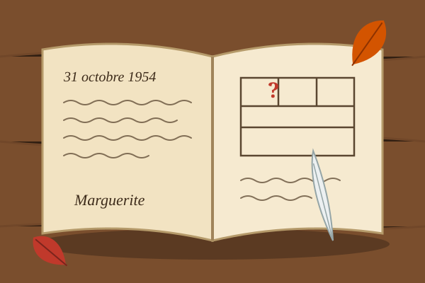
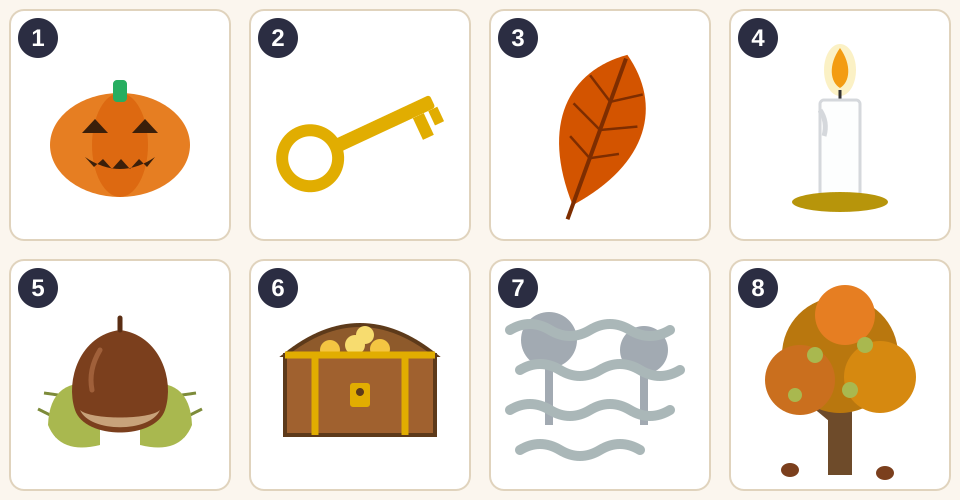
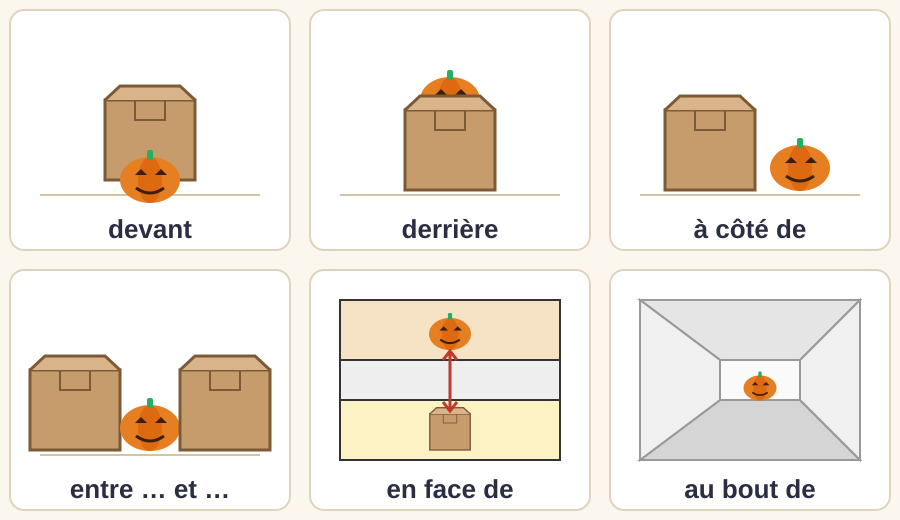
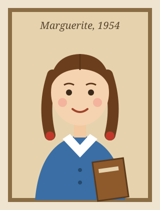
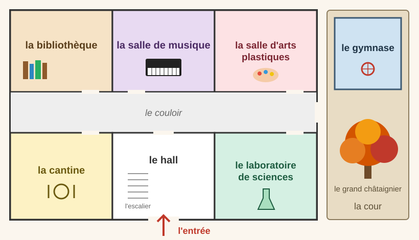
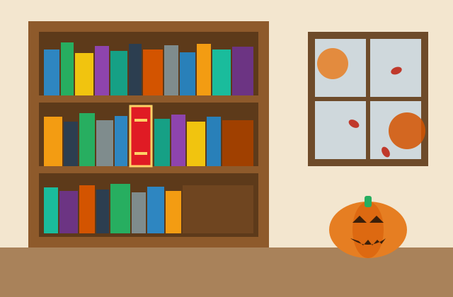
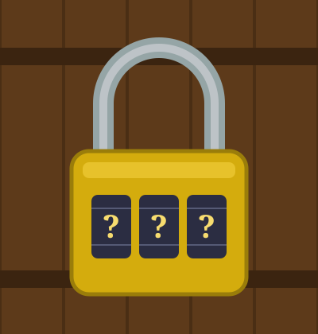
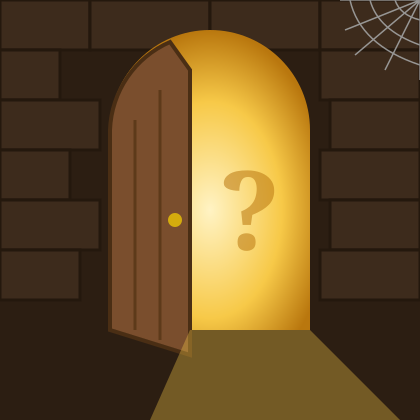

## Le carnet mystérieux

:::: {.columns}
::: {.column width="52%"}
C'est la semaine d'Halloween. Dehors, les feuilles tombent et il fait déjà froid.

Dans une vieille armoire de la classe, tu trouves un petit carnet très ancien. Sur la couverture, il y a un nom : **Marguerite**.

Dans ce carnet, Marguerite parle d'une **salle secrète** dans l'école…

Ta mission : trouver la porte de la salle secrète, comme un vrai détective !
:::
::: {.column width="48%"}

:::
::::

## Les mots de l'enquête {.smaller}

:::: {.columns}
::: {.column width="68%"}

:::
::: {.column width="32%"}
Relie chaque mot à son image.

a. une bougie
b. le brouillard
c. une châtaigne
d. un châtaignier
e. une citrouille
f. une clé
g. une feuille
h. un trésor
:::
::::

## Pour dire où

{height="450" fig-align="center"}

Où est la citrouille ? Fais une phrase pour chaque image.

## La fiche d'enquête

Recopie la fiche. Complète-la pendant l'enquête.

| Pièce | Indice 1 | Indice 2 | Indice 3 | Barrée ? |
|---|---|---|---|---|
| la bibliothèque | | | | |
| la salle de musique | | | | |
| la salle d'arts plastiques | | | | |
| la cantine | | | | |
| le laboratoire de sciences | | | | |
| le gymnase | | | | |

À chaque indice, barre les pièces qui ne correspondent pas !

## Indice 1 : le carnet de Marguerite {.smaller}

::: {style="background:#fbf3e4; padding: 0.6em 1em; border-left: 6px solid #b9770e; font-family: Georgia, serif;"}
*Le 31 octobre 1954*

Aujourd'hui, c'est Halloween. Dehors, il fait froid et il y a du brouillard. Le vent fait tomber les feuilles rouges et jaunes du grand châtaignier, dans la cour.

Pendant la récréation, je suis restée seule à l'intérieur. J'ai trouvé une petite porte cachée ! Derrière cette porte, il y a une salle secrète, toute petite et très sombre.

La porte secrète est dans une pièce de l'école. Dans cette pièce, on ne mange pas et on ne fait pas de sport. Quand je suis devant la porte secrète, j'entends le piano de la salle de musique, de l'autre côté du mur.

Ce soir, j'ai caché mon trésor dans la salle secrète. Si tu lis ce carnet, cherche bien !

*Marguerite, 12 ans*
:::

## Indice 1 : questions

:::: {.columns}
::: {.column width="70%"}
1. Quelle est la date ? Quel temps fait-il ?
2. Qu'est-ce qui tombe du grand châtaignier ?
3. Qu'est-ce que Marguerite a trouvé pendant la récréation ?
4. Vrai ou faux ?
   - La salle secrète est très grande.
   - Marguerite a caché un trésor.
5. Dans quelles pièces la porte secrète **n'est pas** ?

Attention : Marguerite entend le piano **de l'autre côté du mur**…
:::
::: {.column width="30%"}

:::
::::

## Indice 2 : le plan de l'école {.smaller}

:::: {.columns}
::: {.column width="62%"}

:::
::: {.column width="38%"}
Observe le plan. Complète.

1. La salle de musique est **entre** … et …
2. La cantine est **en face de** …
3. Le laboratoire est **en face de** …
4. Le gymnase est **dans** …

La porte secrète est dans une pièce **à côté de** la salle de musique.

Quelles pièces restent sur ta fiche ?
:::
::::

## Indice 3 : le message codé

:::: {.columns}
::: {.column width="68%"}
Sur la dernière page du carnet, il y a un message étrange :

::: {style="text-align: center; font-size: 1.5em; font-family: Georgia, serif; letter-spacing: 0.08em; background:#fbf3e4; padding: 0.4em;"}
EGUOR ERVIL EL ERÈIRRED
:::

Astuce : Marguerite écrit à l'envers, comme dans un miroir !

- Que dit le message ?
- Dans quelle pièce est la porte secrète ?
:::
::: {.column width="32%"}
{height="480"}
:::
::::

## La porte secrète

:::: {.columns}
::: {.column width="55%"}

:::
::: {.column width="45%"}
Tu es dans la bibliothèque, devant l'étagère, contre le mur de la salle de musique.

Tu tires le livre rouge… et l'étagère bouge !

Derrière, il y a une petite porte. Mais elle est fermée avec un **cadenas à 3 chiffres**…
:::
::::

## Activité 4 : le cadenas (vocabulaire)

:::: {.columns}
::: {.column width="65%"}
Trouve les mots. Compte les lettres : chaque mot donne un chiffre du code.

1. Elle tombe des arbres en automne.\
   → une _ _ _ _ _ _ _
2. Elle tombe du ciel quand il fait mauvais.\
   → la _ _ _ _ _
3. C'est un petit fruit marron. On le mange grillé en automne.\
   → une _ _ _ _ _ _ _ _ _

Le code du cadenas : ___ ___ ___
:::
::: {.column width="35%"}
{height="420"}
:::
::::

## Activité 5 : le chemin (oral) {.smaller}

:::: {.columns}
::: {.column width="60%"}

:::
::: {.column width="40%"}
Ton ami entre dans l'école par l'entrée. Explique-lui comment aller à la porte secrète.

- Entre dans l'école…
- Dans le couloir, tourne à … / va tout droit…
- La bibliothèque est … , en face de …
- Dans la bibliothèque, …

Utilise : tourner, aller tout droit, au bout de, à gauche, à droite, en face de, derrière.
:::
::::

## Activité 6 : dans la salle secrète (écriture)

:::: {.columns}
::: {.column width="60%"}
Tu ouvres la porte. Tu entres dans la salle secrète. Qu'est-ce que tu as vu ? Qu'est-ce que Marguerite a caché ?

Écris 5 phrases au passé composé.

```
Je suis entré(e) dans la salle secrète.
J'ai vu ...
J'ai trouvé ...
Marguerite a caché ...
Ensuite, je suis ...
```
:::
::: {.column width="40%"}
{height="440"}
:::
::::

# Bravo, détective !

{height="380" fig-align="center"}

Tu as trouvé le trésor de Marguerite. Joyeux Halloween et bel automne !
