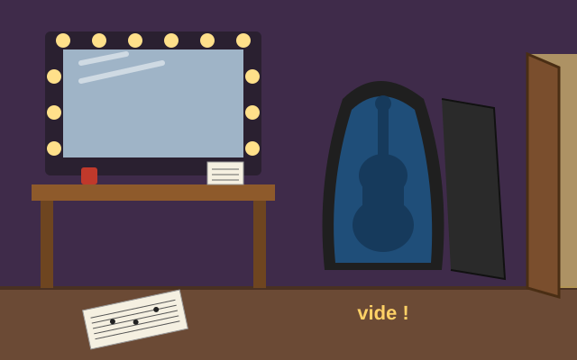
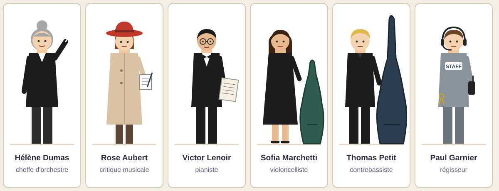
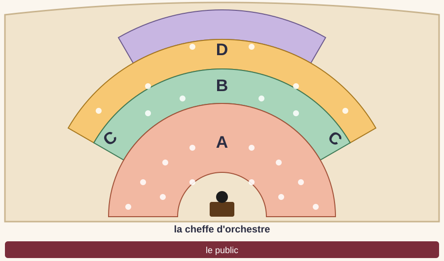
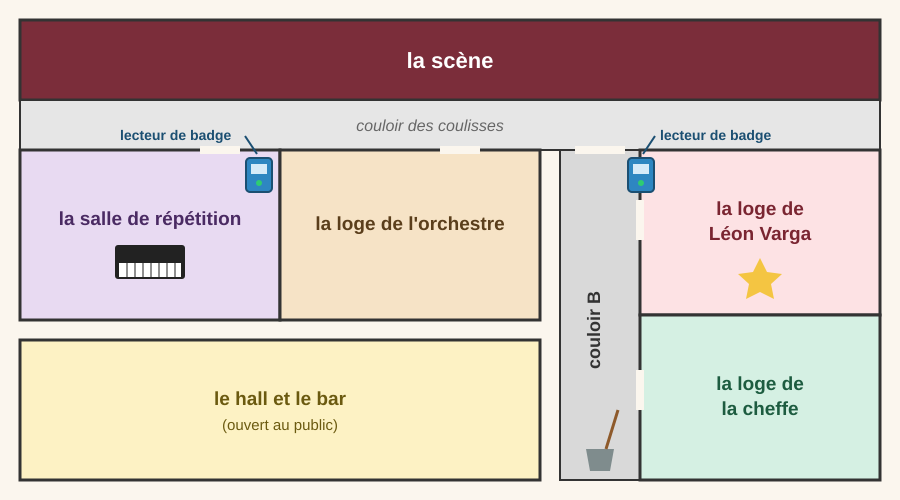
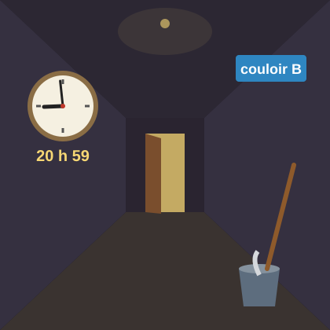
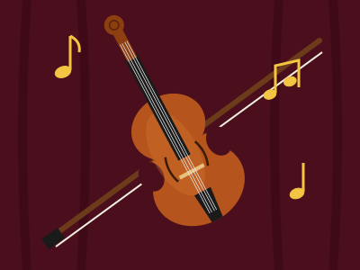

## L'affaire {.smaller}

:::: {.columns}
::: {.column width="60%" style="font-size: 0.76em;"}
Paris, un samedi soir de novembre. Le Théâtre des Lumières affiche complet : plus de mille spectateurs sont venus écouter le célèbre violoniste **Léon Varga**, de retour à Paris après une longue tournée en Asie.

En première partie, il interprète le *Concerto pour violon* de Tchaïkovski avec l'Orchestre des Lumières. Après l'entracte, il doit jouer la *Sonate pour violon et piano* de César Franck avec le pianiste Victor Lenoir.

Léon joue sur « Aurore », un **Stradivarius fabriqué en 1715** à Crémone, en Italie. Le violon a appartenu à plusieurs grands musiciens avant lui, et sa valeur est estimée à plus de dix millions d'euros. Léon ne s'en sépare jamais… sauf pendant l'entracte, quand il le laisse quelques minutes dans sa loge.

À 20 h 45, sous les applaudissements, il quitte la scène, range son violon dans son étui et rejoint sa famille au bar du théâtre. Mais à 21 h 05, quand il revient dans sa loge… **l'étui est vide !**

La police arrive très vite. Les portes du théâtre sont fermées : personne ne peut sortir. Le violon est sans doute encore dans le bâtiment.

**Six personnes sont suspectes. À vous de trouver le coupable.**
:::
::: {.column width="40%"}

:::
::::

## Les suspects

Décrivez chaque suspect : son métier, ses vêtements, ce qu'il ou elle tient.

## Le plan de l'orchestre {.smaller}

:::: {.columns}
::: {.column width="62%"}

:::
::: {.column width="38%"}
Associez chaque zone à une famille d'instruments :

**les cordes · les bois · les cuivres · les percussions**

Puis classez ces instruments :

violon · alto · violoncelle · contrebasse · flûte · hautbois · clarinette · basson · cor · trompette · trombone · timbales

Où sont assis Sofia et Thomas pendant le concert ?
:::
::::

## La fiche d'enquête

::: {style="font-size: 0.75em;"}
Recopiez la fiche. Complétez-la pendant l'enquête.

| Suspect | Badge ? | Dans le couloir B à 20 h 59 ? | Vêtements, étui | Barré ? |
|---|---|---|---|---|
| Hélène Dumas | | | | |
| Rose Aubert | | | | |
| Victor Lenoir | | | | |
| Sofia Marchetti | | | | |
| Thomas Petit | | | | |
| Paul Garnier | | | | |
:::

## Indice 1 : l'article de presse {.smaller}

::: {style="background:#f7f3ea; padding: 0.5em 1em; border-top: 4px solid #FFAC00; font-family: Georgia, serif;"}
**LE STRADIVARIUS DE LÉON VARGA VOLÉ PENDANT L'ENTRACTE**

Coup de théâtre hier soir au Théâtre des Lumières. Le célèbre violon « Aurore », un Stradivarius fabriqué en 1715, a été dérobé dans la loge du soliste Léon Varga, pendant l'entracte du concert.

Le musicien avait laissé son instrument dans son étui à 20 h 45, avant de rejoindre ses proches au bar du théâtre. Lorsqu'il est revenu, à 21 h 05, l'étui était vide. Selon la police, la porte de la loge n'a pas été forcée : le voleur a donc utilisé un badge, car l'accès aux coulisses est réservé aux musiciens et au personnel du théâtre. Les invités, comme les journalistes et les critiques, n'en possèdent pas.

La cheffe d'orchestre, Hélène Dumas, semble également hors de cause : pendant toute la durée de l'entracte, elle a été interviewée en direct par une radio, dans le hall, devant une cinquantaine de spectateurs.

« Ce violon, c'est toute ma vie », a déclaré Léon Varga, très ému. La seconde partie du concert a été annulée et les spectateurs seront remboursés. L'enquête a été confiée à l'inspectrice Morel.
:::

## Indice 1 : questions

1. Qu'est-ce qui a été volé ? Quand et où ?
2. Pourquoi la police pense-t-elle que le voleur avait un badge ?
3. Pourquoi Rose Aubert ne peut-elle pas être la coupable ?
4. Que signifie l'expression « être hors de cause » ? Pourquoi Hélène Dumas est-elle hors de cause ?
5. Trouvez dans le texte un synonyme de « volé ».

Barrez deux suspects sur votre fiche.

## Grammaire : la voix passive {.smaller}

:::: {.columns}
::: {.column width="58%"}
Relevez trois phrases à la voix passive dans l'article.

Puis transformez ces phrases à la voix passive :

1. Le voleur a pris le violon.
2. L'inspectrice Morel dirige l'enquête.
3. Le théâtre remboursera les spectateurs.
4. Un luthier avait réparé l'instrument l'année dernière.
5. Tout le monde admire Léon Varga.
:::
::: {.column width="42%"}
::: {.callout-tip}
## Point grammaire

**être** (au temps de la phrase active) + **participe passé**, accordé avec le sujet.

*La police interroge les musiciens.*\
→ *Les musiciens **sont interrogés** par la police.*

Au passé composé : **a été** + participe passé.\
*Le violon **a été volé**.*

Le complément d'agent est introduit par **par**, ou par **de** avec les verbes de sentiment (aimer, admirer, respecter…).
:::
:::
::::

## Indice 2 : le plan des coulisses

{height="560" fig-align="center"}

## Indice 2 : le journal des badges {.smaller}

:::: {.columns}
::: {.column width="55%"}
::: {style="font-size: 0.85em;"}
| Heure | Badge | Porte | |
|---|---|---|---|
| 20 h 46 | Victor Lenoir | répétition | entrée |
| 20 h 48 | Sofia Marchetti | couloir B | entrée |
| 20 h 53 | Sofia Marchetti | couloir B | sortie |
| 20 h 56 | Thomas Petit | couloir B | entrée |
| 20 h 58 | Paul Garnier | couloir B | entrée |
| 21 h 01 | Thomas Petit | couloir B | sortie |
| 21 h 03 | Victor Lenoir | répétition | sortie |
| 21 h 10 | Paul Garnier | couloir B | sortie |
:::
:::
::: {.column width="45%"}
1. Où se trouve la loge de Léon Varga ? Comment y entre-t-on ?
2. Qui est entré dans le couloir B pendant l'entracte ? Pendant combien de temps ?
3. Où était Victor Lenoir pendant l'entracte ? Peut-il être le coupable ?
4. Qui se trouvait dans le couloir B à 20 h 59 ? Notez-le sur votre fiche.

Barrez un suspect.
:::
::::

## Grammaire : le plus-que-parfait {.smaller}

:::: {.columns}
::: {.column width="58%"}
Complétez avec le verbe au plus-que-parfait. Aidez-vous du journal des badges.

1. Quand Thomas est entré dans le couloir B, Sofia (sortir) ___ déjà ___.
2. À 21 h 05, Léon a découvert que quelqu'un (prendre) ___ son violon.
3. Paul est arrivé à 20 h 58 : Thomas (entrer) ___ deux minutes plus tôt.
4. Victor a expliqué qu'il (répéter) ___ pendant tout l'entracte.
5. Léon (laisser) ___ son violon dans l'étui avant d'aller au bar.

Écrivez deux phrases sur la chronologie de la soirée avec **déjà** et **pas encore**.
:::
::: {.column width="42%"}
::: {.callout-tip}
## Point grammaire

**avoir** ou **être** à l'imparfait + **participe passé**.

Il exprime une action **antérieure** à une autre action passée.

*Quand Léon est revenu, le voleur **était** déjà **parti**.*

Avec **être**, le participe s'accorde avec le sujet :\
*Sofia **était sortie**.*
:::
:::
::::

## Indice 3 : le témoin (écoute et dessin)

:::: {.columns}
::: {.column width="55%"}
Lucie Ferrand fait le ménage au théâtre. Pendant l'entracte, elle travaillait dans le couloir B.

Écoutez son témoignage.

**Dessinez** la personne qu'elle a vue : vêtements, silhouette, objet.

Puis comparez votre dessin avec les suspects.
:::
::: {.column width="45%"}
{height="460"}
:::
::::

::: {.notes}
À lire deux fois, lentement, sans montrer le texte :
« Il était 20 h 59, je m'en souviens parce que je venais de regarder l'horloge. Je nettoyais le fond du couloir B quand j'ai vu quelqu'un sortir de la loge de M. Varga. Je n'ai pas vu son visage, il y avait peu de lumière. Mais je suis sûre d'une chose : la personne était habillée tout en noir, comme les musiciens de l'orchestre. Elle portait sur le dos un énorme étui, plus grand qu'elle. Elle marchait vite, sans faire de bruit. Je ne l'ai pas suivie : j'ai eu peur. »
:::

## Indice 3 : le témoignage de Lucie {.smaller}

::: {style="background:#f7f3ea; padding: 0.5em 1em; border-left: 6px solid #FFAC00;"}
« Il était 20 h 59, je m'en souviens parce que je venais de regarder l'horloge. Je nettoyais le fond du couloir B quand j'ai vu quelqu'un sortir de la loge de M. Varga. Je n'ai pas vu son visage, il y avait peu de lumière. Mais je suis sûre d'une chose : la personne était habillée tout en noir, comme les musiciens de l'orchestre. Elle portait sur le dos un énorme étui, plus grand qu'elle. Elle marchait vite, sans faire de bruit. Je ne l'ai pas suivie : j'ai eu peur. »
:::

1. À quelle heure Lucie a-t-elle vu la personne ? Pourquoi en est-elle sûre ?
2. Quel suspect ne porte pas de vêtements noirs ?
3. Quels suspects ont un grand étui ? Lequel est **plus grand que son propriétaire** ?
4. Relisez le journal des badges : qui était dans le couloir B à 20 h 59 ?

Barrez les derniers suspects. Qui est le coupable ?

## Grammaire : le discours indirect au passé {.smaller}

:::: {.columns}
::: {.column width="58%"}
L'inspectrice Morel écrit son rapport. Rapportez les paroles de Lucie.

1. « Je nettoie le couloir tous les soirs. »\
   → Lucie a dit qu'…
2. « J'ai vu quelqu'un sortir de la loge. »
3. « Je ne suis pas sûre de son visage. »
4. « Je reviendrai demain pour signer ma déposition. »
5. L'inspectrice : « Avez-vous vu son visage ? »\
   → L'inspectrice lui a demandé si…
:::
::: {.column width="42%"}
::: {.callout-tip}
## Point grammaire

Après un verbe introducteur **au passé** (*il a dit que…*), les temps changent :

- présent → **imparfait**
- passé composé → **plus-que-parfait**
- futur → **conditionnel présent**

Les pronoms et les indications de temps changent aussi :\
*je → elle · demain → le lendemain · aujourd'hui → ce jour-là*

Question fermée → **si** : *Elle a demandé **si** elle avait vu…*
:::
:::
::::

## L'accusation {.smaller}

:::: {.columns}
::: {.column width="58%"}
Écrivez votre accusation pour l'inspectrice Morel (6 à 8 phrases). Expliquez votre raisonnement, suspect par suspect, avec au moins **quatre connecteurs** différents.

::: {style="background:#f7f3ea; padding: 0.4em 0.8em; font-family: Georgia, serif;"}
C'est ............ qui a volé le Stradivarius.\
Puisque la porte n'a pas été forcée, ............\
Comme Hélène Dumas ............ , elle ............\
............ , c'est pourquoi ............\
Enfin, ............ donc ............
:::

Lisez votre accusation à voix haute !
:::
::: {.column width="42%"}
::: {.callout-tip}
## Point grammaire

**La cause**

- *parce que* : répond à « pourquoi ? »
- *puisque* : cause évidente, connue de tous
- *comme* : en début de phrase
- *car* : à l'écrit, après la conséquence
- *à cause de / grâce à* + nom

**La conséquence**

- *donc, alors, c'est pourquoi*
- *si bien que* + indicatif
:::
:::
::::

## Les aveux de Thomas {.smaller}

:::: {.columns}
::: {.column width="55%"}
« Oui, c'est moi. Il y a quinze ans, Léon et moi étions au conservatoire ensemble. Nous jouions tous les deux du violon. Le jour du grand concours, quelqu'un a coupé les cordes de mon violon juste avant mon passage. Je n'ai jamais pu le prouver, mais je sais que c'était lui. Il a gagné, il est devenu célèbre… et moi, j'ai abandonné le violon.

Ce soir, je voulais simplement qu'il sache ce que l'on ressent quand on perd son instrument. Le Stradivarius est dans l'étui de ma contrebasse. Je ne l'ai pas abîmé. »
:::
::: {.column width="45%"}

Thomas est-il un simple voleur ? Que pensez-vous de son geste ? Débattez.
:::
::::

## Écriture créative {.smaller}

:::: {.columns}
::: {.column width="58%"}
Choisissez un sujet (200 à 250 mots).

**A.** Vous êtes « Aurore », le Stradivarius. Racontez votre soirée, du concerto jusqu'à votre découverte dans l'étui de la contrebasse : ce que vous avez entendu, senti, pensé.

**B.** Léon Varga écrit une lettre à Thomas. Que répond-il aux accusations de Thomas ? S'excuse-t-il, se défend-il ?

Dans votre texte, utilisez au moins :

- une phrase à la voix passive ;
- un plus-que-parfait ;
- une phrase au discours indirect ;
- une hypothèse sur le passé.
:::
::: {.column width="42%"}
::: {.callout-tip}
## Point grammaire

**L'hypothèse sur le passé** (irréel du passé)

**si** + plus-que-parfait → **conditionnel passé**

*Si Thomas **avait gagné** le concours, il **serait devenu** violoniste.*

*Si Lucie n'**avait** pas **eu** peur, elle **aurait suivi** le voleur.*

Conditionnel passé : **avoir** ou **être** au conditionnel + participe passé.
:::
:::
::::

# Affaire résolue !

{height="360" fig-align="center"}

Le Stradivarius a été retrouvé. Bravo, inspecteurs et inspectrices !
